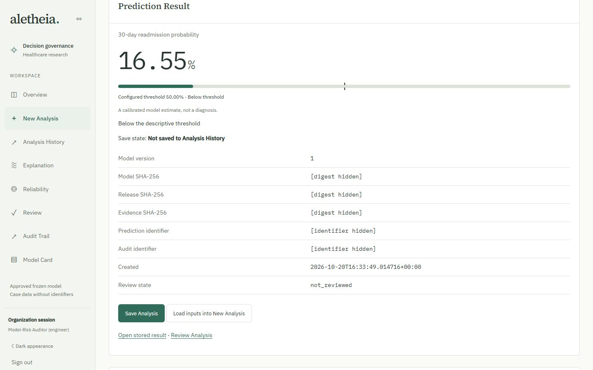
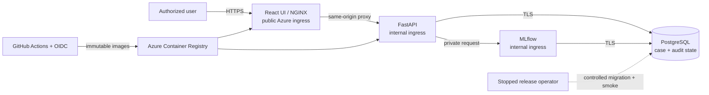

# Aletheia

**An auditable research workbench for manually entered 30-day readmission cases.**

Aletheia connects a frozen, calibrated prediction pipeline to explanations, access-controlled review, persistent history and hash-linked, append-only audit records. It is an educational engineering project, not a clinical decision system.

[Open live application](https://frontend.whiteflower-9d03c62c.southeastasia.azurecontainerapps.io/) · [Architecture](docs/HIGH_LEVEL_DESIGN.md) · [Watch the 60-second walkthrough](docs/assets/demo/walkthrough.webm) · [Documentation](#documentation)

<a href="docs/assets/demo/walkthrough.webm"></a>

## Access

The frontend is publicly reachable. Creating predictions, saving cases, reading authorized history and inspecting audit events require an operator-provisioned, short-lived identity. Public Signup is intentionally unavailable. Temporary reviewer access can be requested from the project maintainer; no token or signing key is published here. Public pages expose the product and approved model evidence without opening the private API or MLflow service.

## In 30 seconds

An authorized user enters a **13-field illustrative case**. The API validates and canonicalizes the fields, applies the approved frozen preprocessing and calibrated model, then returns a probability and a **reference-dependent, noncausal** contribution explanation. PostgreSQL stores the prediction and hash-linked audit event. The user can save, reopen and rerun a case with changed inputs; the original output stays unchanged. The same application has a Docker Compose path and a deployed Azure Container Apps path.

The final hosted Azure workflow passed [run 39417029251](https://github.com/Ameya5006/Aletheia/actions/runs/39417029251) at [source commit `963050e`](https://github.com/Ameya5006/Aletheia/commit/963050edb817b634c9a69fd692ab839c26121bd3). Its preserved evidence includes 58 backend tests, 81 frontend tests, OIDC login, immutable image deployment, migration observation, authenticated public smoke prediction, private service exposure checks and final Azure readback. See the [project report](docs/PROJECT_REPORT.md) for exact evidence bindings and limitations.

## System at a glance



The [high-level design](docs/HIGH_LEVEL_DESIGN.md) covers trust boundaries, deployment and recovery; the [low-level design](docs/LOW_LEVEL_DESIGN.md) covers modules, request paths, data ownership and failure handling. [SOLID and maintainability](docs/SOLID_AND_MAINTAINABILITY.md) assesses the actual code, including its compromises.

## Prediction path

1. **Enter** an illustrative case through 13 labeled fields; the UI checks values against the API-published schema.
2. **Validate** again in FastAPI and canonicalize the input. The server, rather than the browser, owns the authoritative contract.
3. **Infer** with pinned preprocessing, model and calibration artifacts. No training or refitting occurs during a request.
4. **Explain** the output against a published reference case. Contributions describe a model contrast; they do not establish causes or clinical advice.
5. **Commit** the prediction and audit evidence in PostgreSQL. Saving changes visibility in History without rewriting the original output.
6. **Reopen or rerun** with a changed input. A rerun creates a new analysis identity and leaves the saved original intact.

The [sanitized walkthrough](docs/assets/demo/walkthrough.webm) shows the actual public deployment: provisioned sign-in, manual entry, prediction, explanation, save, history, reopen, rerun, audit trail and reset. The [media notes](docs/assets/demo/README.md) explain recording, privacy checks and limits.

## What each technology does

| Component | Responsibility here |
|---|---|
| React + TypeScript | Accessible manual workflow, typed API contracts and role-aware pages |
| FastAPI + Python | Validation, release checks, inference orchestration, authorization and audit writes |
| PostgreSQL + Alembic | Durable case, review and audit state; controlled schema migration through `0004_case_input` |
| MLflow | Private experiment and model-release metadata; approved artifacts remain frozen |
| Docker + Compose | Reproducible local service topology; local volumes hold state |
| NGINX | Serves the frontend and proxies same-origin API calls |
| Azure Container Apps + Container Registry | Public frontend, internal API/MLflow and immutable image deployment |
| GitHub Actions + Azure OIDC | Passwordless hosted build, checks, migration, deployment, smoke and rollback path |
| Pytest, Vitest, Playwright, Ruff | Backend, frontend, browser and lint verification |
| Image scanning, SBOM and licence inventory | Digest-bound component and vulnerability evidence; findings need disposition |

**Storage boundaries:** application PostgreSQL holds cases, grants, reviews and audit events. MLflow uses a separate database role for tracking metadata and approved artifacts. Registry images are deployment bytes, not application records. Local Docker volumes hold local service state. Backups and restore evidence are protected operational artifacts outside the public source tree; none is bundled with this repository.

## How the project developed

| Stage | Objective and deliverable | Verification and lesson |
|---|---|---|
| Problem and governance | Define an auditable educational decision-support boundary | Original vision, approved tasks and report keep claims separate from evidence |
| Data foundation | Version and validate the research data contract | Reproducibility requires data provenance before model comparison |
| Leakage-safe modelling | Train baselines and compare candidate families with fixed splits | Avoid fitting preprocessing on held-out data or optimizing on the final test |
| Calibration and reliability | Measure probability quality and threshold behavior | A useful risk estimate needs calibration; the 0.5 threshold is descriptive |
| Explanation and audit | Preserve model contrasts, stability work and evidence identity | Explanations are reference-dependent and cannot prove causality |
| API and persistence | Add typed endpoints, PostgreSQL state, RBAC and release checks | Server-side validation and transaction boundaries protect invariants |
| Local deployment | Compose services, migrations, backups and security evidence | A runnable stack needs explicit state and secret ownership |
| Manual case workflow | Add 13-field input, save, reopen, rerun, review and audit pages | A rerun must not mutate the prior prediction |
| Azure deployment | Use public frontend, private API/MLflow and TLS database access | Effective ingress must be checked from inside and outside |
| Hosted CI/CD | Federated OIDC, immutable builds, migration, smoke and rollback | Controller observation and actual migration are separate conditions |
| Recovery and security closure | Verify backups, restore, browser behavior, scans and digest binding | A scan exit code is not a claim of zero vulnerabilities |
| Presentation | Document design, record sanitized live media and verify a fresh clone | Public claims must remain bound to preserved evidence |

The [project report](docs/PROJECT_REPORT.md) records experimental rationale, meaningful bugs, trade-offs, results and viva preparation.

## Security and operating limits

- The browser uses a short-lived provisioned JWT; the API checks its signature, issuer, audience and stored entitlements. Roles limit case and audit access. Public Signup and external organizational OIDC remain deferred.
- API and MLflow have internal Azure ingress. The public NGINX route is the intended browser path; TLS protects the public edge and PostgreSQL connection.
- GitHub Actions obtains Azure access through federation. Deployment selects immutable image digests and verifies migration, smoke behavior and post-deployment state. The operator is stopped when idle.
- Backups, restoration and a rollback branch have been exercised and preserved as evidence. Those checks do not prove every future failure can be recovered automatically.
- Exact-image scan reports and SBOMs are digest-bound. A previously scanned frontend image had zero reported vulnerabilities; the backend image retained known findings with documented dispositions. Neither a scanner exit code nor an SBOM is a guarantee of safety or legal clearance. Review the [project report](docs/PROJECT_REPORT.md) before citing counts for a deployed digest.

The source data are historical; representativeness and real-world generalization are unproven. The threshold has low recall in the documented evaluation. Explanations depend on a reference and are noncausal. The cloud showcase has limited monitoring and operator-provisioned access; it has not undergone clinical validation or production governance review. Future work should prioritize governed onboarding, monitoring and prospective validation before any real deployment.

## Run and verify locally

**Prerequisites:** Python 3.12, Node.js 24+, npm and Git for source checks; Docker Engine/Desktop with Linux containers and Compose v2 for the full stack. A fresh clone contains no frozen model bundle, secrets, credentials or backup data. The full serving stack requires the separately approved frozen artifacts; do not train a replacement merely to make it start.

```powershell
python -m venv .venv
.\.venv\Scripts\python.exe -m pip install -r requirements.lock.txt
.\.venv\Scripts\python.exe -m pip install --no-deps --no-build-isolation -e .
.\.venv\Scripts\python.exe -m ruff check src tests
New-Item -ItemType Directory -Force -Path artifacts | Out-Null
.\.venv\Scripts\python.exe -m pytest tests/unit tests/data -m "not live_data" --basetemp=artifacts/fresh-pytest
npm.cmd --prefix frontend ci
npm.cmd --prefix frontend run format:check -- --end-of-line auto
npm.cmd --prefix frontend run lint
npm.cmd --prefix frontend run typecheck
npm.cmd --prefix frontend test
npm.cmd --prefix frontend run build
```

These are source-level checks; database, frozen-artifact and live-browser tests have separate prerequisites. [Local development and verification](docs/LOCAL_DEVELOPMENT.md) gives the checked Compose configuration, environment-file preparation, migration/bootstrap, safe local identity, health checks and non-destructive shutdown steps. [Azure deployment architecture](docs/DEPLOYMENT_ARCHITECTURE.md) explains the hosted route without requiring account identifiers in public copy.

## Documentation

| Read | Purpose |
|---|---|
| [High-level design](docs/HIGH_LEVEL_DESIGN.md) · [Low-level design](docs/LOW_LEVEL_DESIGN.md) | Topology, trust, sequences, modules and data ownership |
| [Architecture record](docs/ARCHITECTURE.md) · [Deployment architecture](docs/DEPLOYMENT_ARCHITECTURE.md) | Approved current architecture and historical decisions |
| [SOLID assessment](docs/SOLID_AND_MAINTAINABILITY.md) | Maintainability and trade-offs |
| [Project report](docs/PROJECT_REPORT.md) | Engineering history, ML learning and verified results |
| [Model card](docs/model_cards/healthcare_readmission_v1.md) · [Local guide](docs/LOCAL_DEVELOPMENT.md) | Model limits and reproducible source/local checks |
| [Local Docker cleanup and recovery](docs/LOCAL_DOCKER_CLEANUP.md) | Backup, rebuild, restore and verification |

**Responsible use:** Aletheia demonstrates engineering and explainability techniques on historical data. Its outputs are not medical advice, a diagnosis, an individual outcome guarantee or a basis for real-world automated clinical decisions.

## Repository metadata

Suggested description: Auditable readmission research workbench with calibrated
prediction, noncausal explanations, case history and protected Azure delivery.
Useful discovery topics: `explainable-ai`, `mlops`, `fastapi`, `react`,
`postgresql`, `mlflow`, `azure-container-apps`, `github-actions`, `model-governance`.
