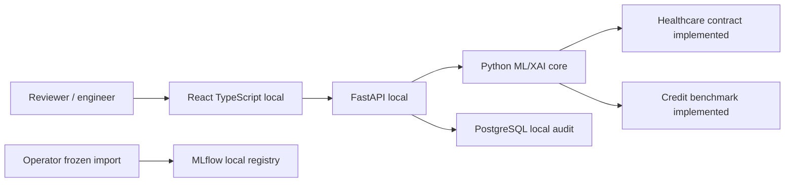

# Aletheia — Explainable AI Decision Auditor

Aletheia is an enterprise-style platform project for reproducible, explainable and auditable high-stakes tabular ML. Its **primary demonstration is 30-day hospital readmission risk** for encounters involving patients with diabetes. The approved South German Credit benchmark remains a **secondary demonstration**. This repository contains both data foundations, a credit training-only baseline and a healthcare model experiment with a locked holdout gate. It has a local Docker Compose application with authorized manual case entry, immutable results and saved analysis history; no public deployment.

## Interactive case workflow — local supervisor review

The authenticated **Overview** shows a neutral "No analysis is selected" state
with **New Analysis** and **Analysis History** links, without a preloaded case or
probability. The authorized workflow starts with an empty **New Analysis** form. Connect
an existing provisioned local identity, enter all 13 required fields, then choose
**Run Analysis**. The frozen model supplies probability/category and version-bound
explanation evidence. Choose **Save Analysis**, open **Analysis History**, and
reopen the immutable result. **Load inputs into New Analysis** makes an editable
copy; changing values and running again creates new prediction/audit identifiers.
**Reset Form** clears unsaved browser state and cannot delete saved records.
Running already records an immutable audit snapshot; Save controls history
membership. No preloaded case or dataset row is required.

Use only the supported encounter fields; do not enter names, account numbers,
patient identifiers or other PII. The complete mapping and count-bound rationale
are in [PROJECT_REPORT.md](docs/PROJECT_REPORT.md). `None` in result categories
means not measured. Count ceilings are computation bounds, not clinical ranges.
Attributions compare with one explicitly disclosed protocol reference and are
noncausal; frozen stability describes model-level research, not the entered case.
No LLM generates predictions or explanation values.

The milestone's existing isolated review stack uses
`artifacts/interactive-verification/resume-20261015b/local/config.env`, project
`aletheia-interactive-20261015b`, and `http://127.0.0.1:18081`. Its frontend was
built with `VITE_LOCAL_IDENTITY=true`; the flag defaults false in other builds.
The backend local-session endpoint separately requires test/development identity
mode. Refresh the existing short-lived provisioned tokens from the repository
root without recreating databases, releases or Stage 3 evidence:

```powershell
$interactiveComposeArgs = @('compose', '--env-file', 'artifacts/interactive-verification/resume-20261015b/local/config.env', '-f', 'deployment/compose.yaml', '-f', 'deployment/compose.test.yaml', '-f', 'artifacts/interactive-verification/resume-20261015b/override.json', '--profile', 'test', '--profile', 'operator')
& docker @interactiveComposeArgs up -d --wait postgres identity mlflow api frontend
.\.venv\Scripts\python.exe deployment/tests/interactive_stack.py tokens
```

Open `/local-session` and supply the provisioned engineer token from the ignored
`local/secrets/engineer_token` file in that evidence directory. The token stays
in memory; refresh/sign-out requires reconnecting. The server still verifies its
signature, expiry, audience and current local role grants. This is the existing
local provisioned-identity mechanism, not Login, Signup, password management or
real external OIDC; those remain deferred. Keep any later cloud deployment
private/access-restricted until production authentication is approved.

Verification used healthy Docker Desktop desktop-linux 29.8.2 after the engine
update, a fresh Compose project, focused tests, real browser/axe checks, fresh
changed-image scans/SBOM/licences and one complete offline regression. Exact
results and security limitations are in
[SUPERVISOR_HANDOFF.md](docs/SUPERVISOR_HANDOFF.md). Historical Stage 3 setup/
restore recipes below are for separate setups; do not rerun preparation into
retained evidence or mistake restore containers for this milestone stack.


## Historical Stage 3 local Docker deployment

`deployment/compose.yaml` implements a loopback-only frontend/proxy, private
FastAPI, PostgreSQL and MLflow, persistent volumes and explicit operator jobs.
Images use digest-pinned Python 3.12.10 (required by the frozen loader), Node
24.20.0, PostgreSQL 18.6 and unprivileged NGINX 1.30.2, with OS security updates
at build time. OS updates require a package mirror, so the base/dependency pins
do not make rebuilt image bytes identical. Record the built image IDs for review.
Image scans still report backend findings; this is not public release approval.
The backend builds checksum-pinned SQLite 3.54.0 separately to fix the inherited
SQLite finding while preserving Python 3.12.10. PostgreSQL starts directly as
UID 70; its unused root-switch helper is removed. The regression image is test-only.
Exact verification, measurements and limitations are in
[SUPERVISOR_HANDOFF.md](docs/SUPERVISOR_HANDOFF.md).

For a **new synthetic test setup** from the repository root, with healthy Docker
Desktop and sufficient disk space, use the pinned Python environment:

```powershell
.\.venv\Scripts\python.exe deployment/tests/prepare.py
$composeArgs = @('compose', '--env-file', 'artifacts/stage3-local/config.env', '-f', 'deployment/compose.yaml', '-f', 'deployment/compose.test.yaml', '--profile', 'test', '--profile', 'operator')
& docker @composeArgs config --quiet
& docker @composeArgs build --builder default
& docker @composeArgs up -d --wait postgres identity mlflow
& docker @composeArgs run --rm migrate
& docker @composeArgs run --rm release-stage
```

On first setup, run the operator actions explicitly before API startup:

```powershell
& docker @composeArgs run --rm release-import operator bootstrap-initial-administrator
& docker @composeArgs run --rm release-import operator import-release --tracking-uri http://mlflow:5000
.\.venv\Scripts\python.exe deployment/tests/prepare.py --tokens
& docker @composeArgs run --rm release-import operator approve-release --tracking-uri http://mlflow:5000 --token-file /run/secrets/operator_token
& docker @composeArgs run --rm release-import operator activate-release --tracking-uri http://mlflow:5000 --token-file /run/secrets/operator_token
& docker @composeArgs run --rm release-import operator grant-role --token-file /run/secrets/operator_token --issuer https://identity.test:8443 --subject synthetic-engineer --role engineer
& docker @composeArgs run --rm release-import operator grant-role --token-file /run/secrets/operator_token --issuer https://identity.test:8443 --subject synthetic-reviewer --role reviewer
& docker @composeArgs up -d --wait api frontend
.\.venv\Scripts\python.exe deployment/tests/verify.py --checks-only
```

Visit `http://127.0.0.1:18080`. The synthetic JWKS fixture provides API test tokens,
not an interactive OIDC login. Browser sign-in remains unavailable without a
real configured provider. Preparation refuses existing setups; refresh only
short-lived test tokens with `prepare.py --tokens`. The release builder copies
verified frozen bytes; it never retrains or reserializes the model.

Further checks, each from the root, use only synthetic data:

```powershell
node deployment/tests/browser.mjs
.\.venv\Scripts\python.exe deployment/tests/recovery.py
.\.venv\Scripts\python.exe deployment/tests/restore.py
.\.venv\Scripts\python.exe deployment/tests/resources.py
.\.venv\Scripts\python.exe deployment/tests/workspace.py
& docker @composeArgs --profile regression build --builder default regression
& docker @composeArgs --profile regression run --rm regression
.\.venv\Scripts\python.exe deployment/tests/scan.py
.\.venv\Scripts\python.exe deployment/tests/security.py
& docker @composeArgs stop
```

The scanner uses the labelled `aletheia-stage3-scanner-cache` Linux volume for
cache/archive staging and retains it. Production images get vulnerability/licence
reports and CycloneDX SBOMs. After a test-image combined scan timed out, that
image uses vulnerability scanning/SBOM plus direct Debian copyright/licence
inventory; the original timeout log is retained. No clean security gate is claimed.

The regression image alone adds Git; its read-only workspace contains a detached
snapshot of the existing HEAD objects/index, without branches, parent history or
stash. Production images contain neither Git nor that metadata. The default
runner executes the full offline suite. `--resume-without-registry` resumes
verification only when all nine `test_registry.py` cases already passed in a
saved run; report both runs and do not claim a single clean full-suite run.

Run resource sampling separately from regression/scanning. `restore.py` quiesces
application writers, backs up both databases and registry/state/release volumes,
then restores to a unique project on loopback port 18081, verifies persisted
prediction/audit/approval and tests revocation there. It stops that project and
retains backup files and rehearsal volumes. It refuses overwrites. Backups are
ignored sensitive operator files and need separate retention/access controls.
`stop` and normal `down` retain volumes; never use `down -v` on retained data.
Restart service containers with `up -d --wait postgres identity mlflow api frontend`;
do not rerun bootstrap, staging, import or activation as startup automation.

For **development/release configuration**, copy `deployment/.env.example` to an
ignored env file, choose an explicit project/port, configure trusted HTTPS OIDC,
token lifetimes, release digest/version and secret directory. Mount individual
`postgres_password`, `owner_password`, `app_password`, `mlflow_password`,
`owner_db_url`, `app_db_url`, `mlflow_db_url`, `identity_ca` (CA trust bundle) and
`operator_token` files. URL users are `aletheia_owner`, `aletheia_app` and
`aletheia_mlflow`; databases are `aletheia_app` and `aletheia_mlflow`. Use strong
distinct credentials and restrict access to the ignored files. Build a verified
release with the existing `operator build-release --destination` command, set
`RELEASE_SOURCE` to its directory and its emitted digest. Use the base Compose
file with `--profile operator`; set `APP_ENV=development` or `release` explicitly.
Release rejects test identity. No credential defaults or provider secrets exist
in Git. `VITE_*` values are public build configuration; changes require rebuilding
the frontend. Set `OIDC_CONNECT_SOURCE` to the matching HTTPS authority origin.
Register `/auth/callback` for code flow/PKCE and grant local roles explicitly.
No real provider or provider logout has been verified. PostgreSQL/MLflow have no
host ports, and this HTTP-only local proxy deliberately emits no HSTS.

## Frontend setup and execution (Macro Milestone 4 Stage 2)

The Stage 1 backend and Stage 2 React/TypeScript frontend are implemented locally.
Real external OIDC-provider integration is unverified; sign-out clears the local
session only. Live OIDC logout remains a Stage 3 verification item. Docker Compose is implemented locally; CI/CD, public hosting and production monitoring remain unimplemented.

Use Node.js 24 or newer and the pinned npm lockfile. From the repository root:

```powershell
Set-Location frontend
npm.cmd ci
Copy-Item .env.example .env.local
npm.cmd run dev
```

The development server proxies `/api` to the separately configured Stage 1 API at
`http://127.0.0.1:8000`. Start that API from the root in the pinned Python environment,
with its existing approved release, PostgreSQL and identity settings configured:
`.\.venv\Scripts\python.exe -m uvicorn aletheia.application.api:app_factory --factory --host 127.0.0.1 --port 8000`.
This command does not import, approve, activate or train a model; follow the existing backend operator
contract for release setup. Missing dependencies/readiness remain visible in the UI.

`VITE_API_BASE_URL` defaults to `/api/v1`. Organization sign-in requires the public
`VITE_OIDC_AUTHORITY`, `VITE_OIDC_CLIENT_ID`, `VITE_OIDC_SCOPE` and
`VITE_OIDC_AUDIENCE` values in `.env.local`; register the frontend origin's
`/auth/callback` as a code-flow/PKCE callback. Use the backend's trusted issuer,
access-token profile and audience, with local entitlements. No client secret belongs
in a `VITE_` variable. Without provider configuration, public evidence is available
and sign-in explicitly reports unavailable. Access tokens stay in memory; reload
requires sign-in again. `.env.local` is ignored; `.env.example` contains public placeholders.

Run these checks from `frontend`:

```powershell
npm.cmd ls --all
npm.cmd run typecheck
npm.cmd run lint
npm.cmd run format:check
npm.cmd test
npm.cmd run build
npm.cmd run test:browser
npm.cmd run contract:check
npm.cmd run licenses
```

Browser tests use installed Microsoft Edge, one worker and HTTP-boundary test
fixtures, including a test-only OIDC provider. They start and stop their own Vite
server on port 4173; no real provider credentials are needed. `contract:check`
uses the root `.venv` (or `ALETHEIA_PYTHON`) to export the real FastAPI OpenAPI
and ten public responses from a temporary verified release, without raw data.
It compares the snapshots rather than updating them silently. `build` produces
ignored `frontend/dist`; `npm.cmd run preview` previews that build, but requires an
API proxy or an explicitly configured API URL/CORS because preview has no dev proxy.
Serve the eventual static build with SPA fallback for deep routes; production
hosting is outside Stage 2. Runtime code contains no fixture fallback.

## Why and for whom

A risk score alone does not tell an ML engineer whether a model generalizes, or a human reviewer why a decision deserves attention. Aletheia's intended workflow joins valid model comparison, calibrated probabilities, explanations, constrained alternatives, subgroup checks, similar training cases and durable audit evidence. Intended users are ML engineers, human risk/clinical reviewers, and administrators. The healthcare demonstration is educational and **not a clinical decision support device or treatment recommendation**. It must not process real patient submissions in a public demo.

The local engineer workflow implements source/split verification, group-aware model comparison, calibration, a frozen model and immutable research audit evidence. The FastAPI/PostgreSQL/MLflow backend and React UI support independently entered cases, saved immutable analyses, review/audit persistence and operator release/entitlement workflows, alongside the earlier protocol-case route. Real external OIDC-provider integration remains deferred. Local Compose is implemented; public deployment, CI/CD, production monitoring and LLM/RAG remain unimplemented.

## Current capabilities and roadmap

**Implemented:** official UCI 296 source identity and byte hashes; controlled extraction; strict 50-column loading; `?` normalization in seven documented fields; target/cohort/role validation; a frozen patient-group holdout; patient-aware nested CV, bounded candidate comparison, raw/sigmoid calibration comparison, immutable local experiment records and one-time holdout protection. Credit has an approved 1,000-row foundation and training-only Dummy/Logistic Regression baseline with immutable local manifests.

The completed healthcare experiment selected sigmoid-calibrated Histogram
Gradient Boosting using training-only patient folds. Its single locked-holdout
evaluation measured ROC-AUC 0.6395 and average precision 0.2026 on 19,535
encounters; at descriptive threshold 0.5 it detected 12 of 2,240 positives.
The full metrics and patient-cluster intervals are in the
[model card](docs/model_cards/healthcare_readmission_v1.md). These are
retrospective educational results, not clinical validation.

**Macro Milestone 3 implementation:** source-field sampled Shapley explanations
of the complete calibrated probability; global repeated-sample evidence;
deterministic local explanations with a fixed synthetic publication example;
bounded count-recording stability; support-guarded race/gender/source-age-band
evaluation with patient-cluster intervals; explicit no-recourse feasibility
assessment; frozen protocols and exclusive audit artifacts. Verification and
measured results are recorded in the model card, project report and handoff.

**Implemented locally in Milestone 4 Stages 1–2:** MLflow import/registry,
FastAPI, PostgreSQL, JWT/local-entitlement RBAC and React/TypeScript.
**Unimplemented:** similar-case retrieval, GitHub Actions and
production monitoring.
**Deferred hosting choices:** DagsHub-hosted MLflow, DVC versus
source hashes/locks, managed host, optional Hugging Face demo and optional
OpenRouter narrator. **Rejected:** RunwayML, which has no role in tabular auditing.
Similar-case retrieval is not collaborative filtering; a recommendation project
would be separate. Clinically actionable counterfactual search remains unjustified.

Five macro milestones are on the roadmap: (1) healthcare foundation and
deployable design **committed and externally reviewed**; (2) frozen healthcare
modelling/calibration **completed**, committed at `49a1a8c`; (3) explanations and audit methods
**completed and externally approved at `ff9dce291`**; (4) application and MLOps; (5) public delivery
and operations. Definitions of done are in [the execution plan](docs/EXECUTION_PLAN.md).
Milestone 4 Stages 1–3 are implemented locally; Milestone 5 remains unimplemented. Only the current task and explicit supervisor repair authorize work; completion does not authorize progression.

**Historical Macro Milestone 4 Stage 0:** documentation-only application contract prepared
for supervisor review. The first application will serve verified aggregate
audit evidence and the fixed synthetic local example, with authenticated live
inference limited to `synthetic-discharge-v1`. It will accept no patient uploads
or editable clinical inputs. MLflow will import the existing calibrated bundle
without training; FastAPI/PostgreSQL will record synthetic predictions and
review decisions under OIDC/RBAC; React/TypeScript and local Compose remain
planned. The [application contract](docs/ARCHITECTURE.md),
[screen contract](docs/PRODUCT_REQUIREMENTS.md),
[local runtime contract](docs/DEPLOYMENT_ARCHITECTURE.md),
[gated stages](docs/EXECUTION_PLAN.md) and
[ADR 0008](docs/decisions/0008-application-mlops-contract.md) specify the design.
Stage 0 authorizes no implementation, dependencies or service startup.

## Architecture and data flow



**Implemented healthcare research flow:** official UCI archive → size/SHA-256 verification → safe two-file extraction → exact CSV/schema check → `?` normalization and target mapping → discharge-eligible cohort → separate predictor/audit views → patient-group split lock → training-only nested patient CV → frozen selection → full-training fit → exclusive holdout claim → one evaluation and model card → unchanged calibrated model with training-only XAI/stability, counterfactual feasibility and one separately guarded subgroup audit → aggregate audit evidence. **Implemented local prediction flow:** authenticated complete case input → strict schema and approved-version validation → canonical source strings → frozen preprocessing/model/calibrator → probability and disclosed reference contrast → atomic immutable snapshot/audit/idempotency record → response → optional Save marker → scoped history/reopen. Delivery code calls the core without fitting or duplicating preprocessing. The earlier fixed protocol-case route remains compatible.

## Healthcare dataset and leakage boundary

Source: [UCI Diabetes 130-US Hospitals for Years 1999–2008](https://archive.ics.uci.edu/dataset/296/diabetes+130-us+hospitals+for+years+1999-2008), ID 296, DOI [10.24432/C5230J](https://doi.org/10.24432/C5230J), CC BY 4.0; see [Strack et al. 2014](https://doi.org/10.1155/2014/781670). There are 101,766 raw inpatient encounters, 50 columns and 71,518 patient IDs. The target is `readmitted_30d=1` for `<30`; `>30` and `NO` are 0. The prediction time is **discharge**, after disposition is known and before the 30-day outcome is known. Death/hospice dispositions are excluded, leaving 99,343 encounters and 69,990 patients. The encounter key is `uci296-<encounter_id>`; `patient_nbr` is used for grouping. Both identifiers, discharge disposition and sensitive race/gender/age are barred from predictors. The policy currently allows 13 conservative discharge-time fields. Exact source/missingness/field decisions are in the [healthcare audit](docs/HEALTHCARE_DATASET_AUDIT.md).

The SHA-256 patient-group split assigns approximately 80%/20% independent of labels: training 79,808 encounters (70,734 negative, 9,074 positive; 56,178 patients), locked holdout 19,535 (17,295 negative, 2,240 positive; 13,812 patients). No patient or encounter crosses. Modelling CV also groups patients in five outer and three inner folds. The dataset lacks dates/hospital IDs, so this split is not temporal or external validation. Missing race and sparse subgroups constrain the implemented subgroup audit; historical administered treatments and counts are not automatically actionable counterfactuals. Similar-case retrieval may use only authorized training cases with privacy controls and a versioned distance metric.

## Technology and connection map

Status is explicit. Configuration and artifacts are detailed in [deployment architecture](docs/DEPLOYMENT_ARCHITECTURE.md).

| Tool | Status, use and connection | Configuration, limits and alternative |
|---|---|---|
| Python 3.12, pandas, scikit-learn | Implemented credit baseline and healthcare data/model/calibration/XAI/audit core; CLI produces validated tables, frozen model evidence and aggregate audit records | `pyproject.toml`, `requirements.lock.txt`, versioned TOML; 8 GB laptop limits. Fold-local fit required. Polars is an unneeded alternative. |
| Healthcare nested-CV runner and local joblib | Implemented research experiment; frozen selection and checksummed model live under ignored `artifacts/healthcare-model-v1` | `configs/experiments/healthcare_model_v1.toml`; trusted local artifact only, never load user-supplied pickle/joblib. The one-time holdout claim prevents reruns. |
| Local JSON manifests | Implemented for credit and healthcare model/audit evidence; research runners write ignored artifacts | `artifacts/runs`, `artifacts/healthcare-model-v1`, `artifacts/healthcare-audit-v1`; research history preserved separately from the local MLflow import. |
| MLflow | Implemented local frozen import, historical metrics and registry lifecycle | `MLFLOW_TRACKING_URI`; no training/PHI; outage blocks promotion, verified pinned serving can continue. |
| DagsHub-hosted MLflow | Deferred remote alternative after local self-hosted v1 | Future secret endpoint/credentials, non-sensitive metadata only; cost/retention review. |
| DVC | Provisional data pointer/version tool for training | Current raw SHA-256 + split lock suffice for UCI; remote storage and cost must be justified before adoption. |
| FastAPI | Implemented local typed REST layer calling research use cases | Registry URI, `DATABASE_URL`, auth issuer/audience; validate and rate-limit. Django REST is heavier. |
| PostgreSQL | Implemented local transactional append-only audit/version metadata | Secret `DATABASE_URL`, migrations/least privilege; audit write failure blocks served decision. SQLite is weaker for concurrent managed use. |
| React + TypeScript | Implemented local reviewer browser interface calling API JSON | `VITE_API_BASE_URL`; no PHI browser persistence. Next.js adds unneeded server surface. |
| Docker + Compose | Implemented local API/static images and Compose stack | Pinned bases, secret files and health checks; Compose is not public orchestration. Host installs drift. |
| GitHub Actions | Selected CI tests/build/deploy gate and future code dependency graph artifact | Future protected environments/OIDC; no raw data on runners. Local checks remain fallback. |
| Managed public host | Provisional API/UI and managed PostgreSQL deployment | Vendor, region and cost unresolved; synthetic examples only. Self-hosting costs more operations. |
| Monitoring/drift | Selected aggregate service/model checks after deployment | Versioned baselines/alerts; drift is not proof of harm. Manual review fallback. |
| Hugging Face cards | Selected future model/dataset provenance and limitations | No sensitive artifact upload; repository Markdown fallback. Hosted demo provisional and synthetic only. |
| OpenRouter narrator | Provisional optional prose from computed explanations | Future API key secret; no patient values, hallucination/cost risk. Deterministic templates default. |
| Authentication/RBAC, append-only audit | Implemented JWT/local-entitlement enforcement and prediction/review trail in API/PostgreSQL | External OIDC integration unverified; database admins still require governance. No anonymous real-data serving. |
| RunwayML | Rejected media generation service | No tabular audit requirement; reconsider only for a real media use case. |

## Repository map

`src/aletheia/data`, `ml`, `experiments` contain the existing credit pipeline. `src/aletheia/domains/healthcare` contains the foundation, modelling, evaluation, experiment and CLI. `configs/datasets`, `features`, `splits`, `experiments` hold healthcare identities, roles, split lock and modelling protocol; credit configurations remain. `src/aletheia/application`, `migrations`, `tests/application` and `frontend` contain local delivery code and tests. `tests/healthcare` contains offline tests; `docs` records audit, architecture, decisions, model card, report and supervisor evidence. Raw data and run artifacts are ignored.

Healthcare `explain.py`, `stability.py`, `fairness.py`, `counterfactual.py` and
`audit.py` compose the research audit. Its protocol is
`configs/audit/healthcare_audit_v1.toml`; [ADR 0007](docs/decisions/0007-healthcare-explanation-responsible-audit.md)
records the method, alternatives and gates. No new package was installed.

## Installation and commands

Use Python 3.12 in a virtual environment; the lock includes Stage 1 application dependencies. The commands below preserve historical research setup, not authorization to rerun the completed model or audit. From the repository root:

```powershell
py -3.12 -m venv .venv
.\.venv\Scripts\python.exe -m pip install -r requirements.lock.txt
.\.venv\Scripts\python.exe -m pip check
.\.venv\Scripts\python.exe -m aletheia.domains.healthcare acquire
.\.venv\Scripts\python.exe -m aletheia.domains.healthcare verify
.\.venv\Scripts\python.exe -m aletheia.domains.healthcare model
.\.venv\Scripts\python.exe -m ruff check .
.\.venv\Scripts\python.exe -m ruff format --check .
.\.venv\Scripts\python.exe -m pytest -m "not live_data"
```

The archive and CSV go under ignored `data/raw/healthcare`. `acquire` downloads only the official HTTPS archive, verifies byte identity and extracts two approved members. On a local Python TLS certificate failure, obtain the same official URL through a trusted TLS-capable client into that ignored path, then rerun `acquire`; never bypass checksum validation. `verify` checks the frozen lock and prints partition sizes. `lock` creates a new lock only if absent and is for protocol regeneration under approval; it refuses overwrite. `model` is a single-use experiment: it runs training-only evidence twice, freezes selection, then claims and evaluates the holdout once. It refuses an existing run directory; do not delete a completed run to tune against its result. Configuration files are versioned TOML; no credentials are needed now. The local API uses environment-backed secrets; `.env` files stay ignored. The ordinary test suite is synthetic and offline; `live_data` tests are opt-in.

The audit uses the preserved model and raw CSV; it never trains. Before the first
audit, run the protocol tests, then these commands in the pinned environment:

```powershell
.\.venv\Scripts\python.exe -m aletheia.domains.healthcare.audit freeze
.\.venv\Scripts\python.exe -m aletheia.domains.healthcare.audit run
.\.venv\Scripts\python.exe -m aletheia.domains.healthcare.audit inspect
```

The audit has completed locally; use `inspect` for the existing evidence.
The first two commands exclusively reserve
`artifacts/healthcare-audit-v1`; do not delete or overwrite an existing run or
claim. A failed claimed audit needs supervisor review. Use
`python -m aletheia.domains.healthcare.audit inspect` to verify saved hashes,
bindings and publication privacy without recalculating outcomes. The local
example's values are synthetic; real local patient evidence is not published.

## Limits, licence and review

The UCI records are historical (1999–2008), omit hospital/date identity, contain
missing and rare groups, and have no clinical or external validation. Predictive
and subgroup evidence use the frozen retrospective patient split. XAI uses a
small training reference and marginal combinations that may be unlikely;
stability is a limited recording-sensitivity probe. No clinical recourse,
fairness certification, latency claim, security certification or deployment is
established. Aggregate publication is not formal differential privacy. The repo's
software licence should be checked before reuse; dataset reuse follows
**CC BY 4.0** with UCI/Strack attribution. This is not medical advice.

Read [product requirements](docs/PRODUCT_REQUIREMENTS.md), [dataset audit](docs/HEALTHCARE_DATASET_AUDIT.md), [architecture](docs/ARCHITECTURE.md), [deployment design](docs/DEPLOYMENT_ARCHITECTURE.md), [execution plan](docs/EXECUTION_PLAN.md), [project report](docs/PROJECT_REPORT.md), [credit audit](docs/DATASET_AUDIT.md), [ADRs](docs/decisions), and [supervisor handoff](docs/SUPERVISOR_HANDOFF.md).
CURRENT_TASK.md authorizes Stage 3 only. Local backend/frontend and Compose exist;
exact acceptance status is recorded in SUPERVISOR_HANDOFF.md.
No subsequent milestone or Git mutation is authorized.
