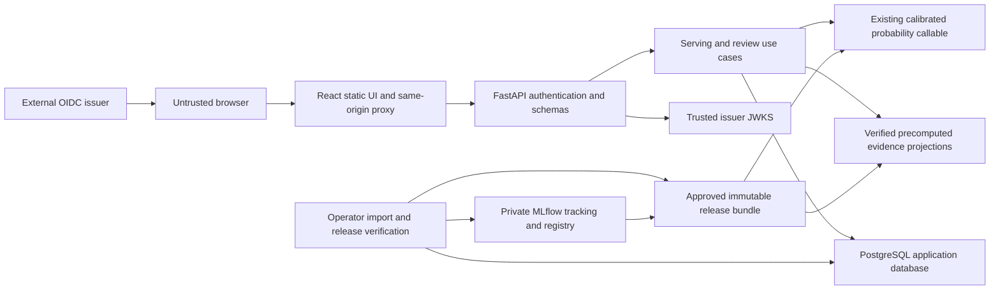
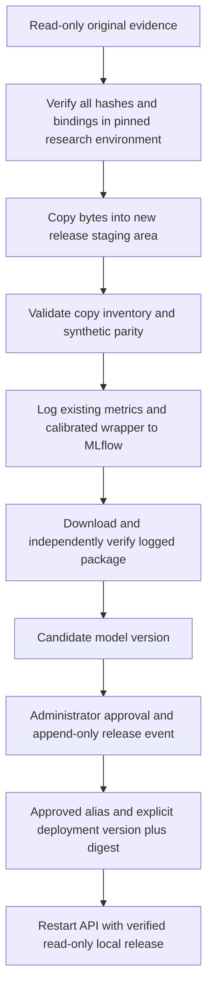
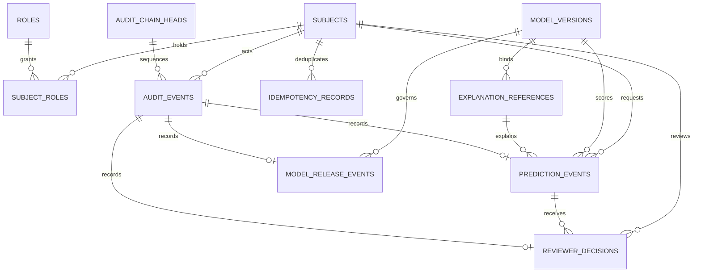
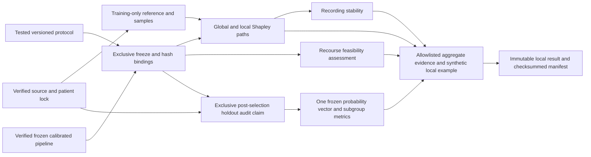
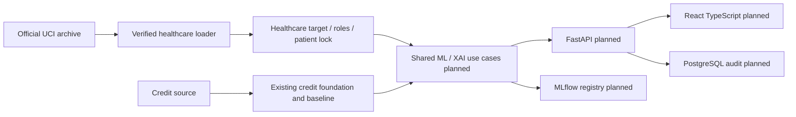

# Aletheia — System Architecture

## Macro Milestone 4 — Local application architecture

**Current status:** Stage 1 FastAPI/PostgreSQL/MLflow, transactional synthetic
prediction/review/audit and JWT/local-entitlement RBAC are implemented in
`src/aletheia/application` and `migrations`; Stage 2 React/TypeScript is implemented
in `frontend`. Real external OIDC-provider integration is unverified. Sign-out
clears the local session; live OIDC logout remains a Stage 3 verification item.
Docker Compose, CI/CD, public hosting and production monitoring are unimplemented.
ADR 0008 and the detailed Stage 0 specification below preserve the approved design;
its proposed commands/schemas/limits are historical contract text, not additional
implemented capabilities. The committed API/OpenAPI and frontend routes are the
implementation source of truth; Stage 1/2 verification is in PROJECT_REPORT.md.

### Historical Stage 0 application contract v1

### Components, dependency direction and threat boundaries

Current architecture: one Python research package, trusted local joblib model
bundle, six original model files and four aggregate audit files. No application
services exist. Proposed change: add delivery adapters, a registry import
adapter, transactional persistence and a browser client around that evidence.
Research modules keep their existing interfaces and must not import delivery
frameworks. New modules will wrap them; bound healthcare source/tests/configs
must not be edited merely to make serving convenient. No research artifact
format migration occurs. A separate release manifest describes copied bytes,
wrapper code, serving schema and environment without rewriting old manifests.
Database schema and HTTP APIs are new, so there are no existing users/rows/API
clients to migrate. Cross-platform byte identity and synthetic parity tests are
required before the proposed import is accepted.

The browser, tokens, URL IDs and HTTP bodies are untrusted. API-to-database uses
a non-owner role; migration owner, MLflow credentials and promotion operator are
separate trust boundaries. MLflow is private and is not the public inference
server. Hashes detect byte changes; an independently approved release digest is
the trust anchor. A malicious operator able to replace both artifacts and the
anchor defeats this control. No checksum can make an arbitrary pickle safe.

### Product and explanation-serving boundary

Select **both** precomputed verified evidence and restricted synthetic inference.
Public visitors read aggregate evidence, model card and the fixed synthetic
local example. Authenticated engineers/reviewers/admins may request one live
synthetic demonstration. Its only input is `case_id=synthetic-discharge-v1`,
mapped server-side to the 13 exact values in the existing audit configuration.
There is no editable feature form, record upload, free text, bulk endpoint or
arbitrary de-identified input in v1. De-identification alone would not establish
privacy or clinical validity, so it requires a separate future contract.

On-demand scoring uses `explain.probability(bundle, frame)` including the
separate calibrator. It does not call a training/evaluation/audit runner. Local
explanation is the existing `results.json.synthetic_local` only. Prediction
probability must match that stored case within absolute tolerance `1e-10` before
the release is approved; no live attribution or patient reference is needed.
Global, stability, subgroup and feasibility endpoints project their matching
saved result sections. Null metrics, suppressed counts, sampling semantics,
calibrated output, uncertainty and limitations remain visible without rebins,
new statistics or fair/unfair badges. No recourse candidate or similar-case
retrieval is offered. Public presentation is planned; it is not deployed here.

Trade-off: precomputed evidence is inexpensive and preserves the registered
methodology; one fixed live case demonstrates exact serving and audit writes but
does not demonstrate general patient intake. Arbitrary local XAI would require
approved reference storage/privacy, method, sampling and latency budgets.
The API and images must not contain raw CSV, patient rows or training references.

### Frozen model and MLflow lifecycle

The artifact is a dictionary with `model` and `calibrator`, not an estimator
whose `predict_proba` alone is calibrated. Model SHA-256 is
`8c3a99dd8dfe20d2a3a0a721637b4be500ee1b32843f7cefc3af265f07262f7a`;
selection SHA-256 is
`85db5e79faacc80d9818b235c4e8338be0aeb10fbcf89da2f3bc56e87172e9a7`;
audit result SHA-256 is
`2d073fa0d0bbbd4debfdf445cd80ec478fef0f7098c7ef356dbb3edd28894ea8`.
Use the complete recorded identities, not these three checks alone.

Proposed conventions: experiment `aletheia-healthcare-frozen-import-v1`, run
name `import-healthcare-model-v1-<model hash prefix>-<release hash prefix>`,
registered model `aletheia-healthcare-readmission`, monotonically allocated
MLflow numeric version, aliases `candidate`, `approved`, `previous`. Version
tags include research revision, selection/model/audit/protocol/config/split
hashes, wrapper/schema version, approval status and approver event ID. Log
existing aggregate metrics with `historical_holdout_` or `historical_cv_`
prefixes and scope tags; they are imported measurements, not a new MLflow
evaluation. Do not use deprecated stage names as the approval mechanism.

Import is an operator command in a later stage, never an HTTP upload. First run
the existing read-only inspector in its pinned original environment, which
validates source/test/config/model bindings without patient-data loading. Copy
all six original model files, four audit files and every byte-bound provenance
file into private release storage without newline conversion. Preserve the
split's CRLF checkout rule. Frozen Windows byte digests must not be replaced
by hashes of a Linux checkout. A byte-preserving archive of original files is
the provenance snapshot; new application source is a separate package.

Create a custom MLflow pyfunc wrapper for the complete calibrated callable,
with a 13-column ordered string input signature and one class-1 probability
output. Package the existing joblib bytes as an artifact, with guarded loading
inside the adapter. Use reviewed wrapper code (models-from-code), rather than
logging only the base sklearn estimator or reserializing the old bundle. Verify
the full downloaded MLflow package and reviewed code before any MLflow loader
executes; verify the inner joblib, protocol and exact recorded versions before
deserialization. Adapt trusted path handling in new delivery code: the old
loader requires parent name `healthcare-model-v1`, so preserve that layout and
also enforce an absolute release-root allowlist, reject symlinks/path traversal,
and mount it read-only. No client model URL, joblib upload or arbitrary URI is
accepted. Explicit synthetic examples prevent automatic signature/dependency
inference from accidentally inspecting real data. No `fit`, `evaluate_once`,
`audit freeze/run`, raw loading or holdout scoring is part of import.

The approved release manifest includes every original byte hash, canonical
protocol identity, wrapper and MLflow package hashes, exact research runtime
(Python 3.12.10 and recorded sklearn/pandas/NumPy/SciPy versions), new application
dependency lock, signature, synthetic case hash, tolerance and approval event.
Stage 1 must verify availability and compatibility of this runtime before
adding packages; incompatible versions are a blocker, not permission to refit.
No release or MLflow record is created during Stage 0.

Registration retries identify the same release digest and reuse a verified
run/version; conflicting partial runs stay failed/quarantined, never approved.
An administrator operator reviews identity, tests and privacy, records approval
in PostgreSQL and assigns aliases. MLflow and PostgreSQL are not one atomic
transaction: reconcile both, then publish an explicit deployment pin only after
their records agree. Failure between steps blocks deployment and requires
reconciliation; an alias alone is insufficient. Rollback selects a previously
approved exact version/digest, records the change, updates aliases and restarts
with that pin. No metric-based automatic promotion or per-request alias lookup.

The API consumes an already verified local release pin and PostgreSQL approval
record. An MLflow outage blocks import/promotion/refresh; a healthy running API
may continue using the unchanged approved read-only release. A cold start can
use that same digest-verified cache and DB approval; absent cache/approval fails
readiness. No fallback to an unregistered model or mutable `latest` file. A
revoked approval or checksum mismatch disables serving. Public evidence can
remain available from its independently verified projection when inference is
unready, with an explicit service-status notice.

Official references consulted for planning: [registry aliases and workflows](https://mlflow.org/docs/latest/ml/model-registry/workflow/),
[artifact storage](https://mlflow.org/docs/latest/self-hosting/architecture/artifact-store/)
and [reviewable wrapper code](https://mlflow.org/docs/latest/ml/model/models-from-code/).
These support the integration mechanism; project compatibility is still untested.

### HTTP contract and permissions

All application routes use `/api/v1`; breaking changes require `/api/v2`.
`P` is unauthenticated public read, `E` engineer, `R` reviewer, `A` administrator.
Roles are independent: administrator does not implicitly acquire reviewer
permission. Multiple explicitly assigned roles may be combined.

Audit-event RBAC uses the same server-side resource checks as prediction/review
lookup, on both list and detail routes:

| Role | Audit visibility |
|---|---|
| Engineer | own events only (`actor_id` equals the authenticated subject) |
| Reviewer | prediction/review events only, joined to predictions and reviews the subject is authorized to access; no release, entitlement, bootstrap or other system-wide events |
| Administrator | all events, including release, entitlement and system-wide events |

V1 reviewers can access persisted fixed-synthetic predictions/reviews under the
endpoint permissions below; that does not authorize unrelated event types.
Enforce the event-type allowlist and resource authorization before pagination;
reject guessed inaccessible event IDs with 404. Hash links do not grant access to
adjacent events, and the UI must not claim a filtered history verifies the full chain.

| Method and path | Allowed roles | Input | Output data schema |
|---|---|---|---|
| GET `/health/live` | P,E,R,A | none | `Live{status:alive}`; no dependency calls |
| GET `/health/ready` | P,E,R,A | none | `Ready{status:ready|unready}`; 200 or 503, no secrets |
| GET `/models/current` | P,E,R,A | none | `ModelMetadata{domain,target,family,calibration,feature_policy_version,threshold:0.5,approval_status,serving_available}` |
| GET `/models/current/card` | P,E,R,A | none | `ModelCard{content_markdown,card_sha256,intended_use,limitations}` |
| GET `/demo/cases` | P,E,R,A | none | fixed `SyntheticCase{id,source:synthetic,features}` list of one |
| POST `/predictions` | E,R,A | `PredictionRequest{schema_version:application-v1,case_id:synthetic-discharge-v1,model_version:string}` | 201 `Prediction{prediction_id,case_id,input_sha256,probability,positive_class:1,threshold:0.5,class_at_threshold:0|1,explanation_ref,event_id}` |
| GET `/predictions/{prediction_id}` | owner E/R/A; other R/A | UUID | persisted `Prediction`; 404 for absent/inaccessible |
| GET `/explanations/global` | P,E,R,A | none | saved `global` object: method/output/population/samples/seeds/baselines/features/repeat ranges/limitations |
| GET `/explanations/local/synthetic-discharge-v1` | P,E,R,A | none | saved `synthetic_local`: identity/method/output/baseline/probability/features with signed contributions/limitations |
| GET `/audits/stability` | P,E,R,A | none | saved `stability`: bounds, comparisons, crossings, all/same/crossed summaries, undefined counts, flags, limitations |
| GET `/audits/subgroups` | P,E,R,A | none | `SubgroupAudit{groups,threshold:0.5,methodology,limitations}`; saved group counts/status/reason/metrics/uncertainty |
| GET `/counterfactuals/feasibility` | P,E,R,A | none | saved `counterfactual`: no-feasible-scenario, empty candidates, no-search flag, assessment/immutable fields/worked example |
| GET `/audit-events` | E own; R authorized prediction/review events; A all | cursor optional, limit 1–100 default 20 | `Page<AuditEvent>` descending sequence and opaque next cursor; authorization filter before pagination; no actor identities for other users |
| GET `/audit-events/{event_id}` | E own; R authorized prediction/review events; A all | UUID | `AuditEvent{id,sequence,type,resource_id,occurred_at,request_id,payload,prev_hash,event_hash,chain_version}`; redacted allowlist; 404 for absent/inaccessible |
| POST `/predictions/{prediction_id}/reviews` | R | UUID and `ReviewRequest{schema_version,decision:acknowledged|needs_investigation|dismissed_demo,reason_code:evidence_reviewed|limitations_noted|identity_issue,expected_revision:nonnegative int}` | 201 `Review{review_id,prediction_id,revision,decision,reason_code,event_id,created_at}` |
| GET `/predictions/{prediction_id}/reviews` | owner E; R/A | UUID | `Page<Review>` latest revision and append-only history |
| GET `/admin/model-versions` | A | cursor, limit 1–100 | `Page<ModelVersion>` explicit MLflow run/version, digests, approval and release-event history |
| GET `/admin/model-versions/{version}` | A | positive numeric MLflow version string | `ModelVersion` with package/signature/runtime identities, approval events and serving pin |

Health paths are also under `/api/v1`. All 200/201 JSON responses use
`{schema_version:application-v1,request_id:UUID,data:...,evidence:...}`.
Except health, evidence contains domain `healthcare`, explicit numeric MLflow
`model_version`, model SHA-256, audit protocol/result hashes and research
revision. Every evidence/result response includes `educational_only:true`,
`not_medical_advice:true`, source `precomputed_research|synthetic_inference`,
and limitations. Public metadata uses the last approved projection; it must
identify unavailable live serving. Serve no private paths, run credentials,
claim internals or download link for executable artifacts. Arrays/field order
follow the existing audit schema; probability is finite in [0,1], contributions
are signed probability units, undefined numbers are JSON null, and suppressed
counts remain `<20` strings. No silent numeric rounding in stored API data.

The POST model version must equal the deployment pin; stale values return 409,
preventing a UI from reviewing evidence for a different model. Input schemas
reject unknown properties, free text, patient/demographic fields, nested feature
objects and files. Store only server-defined synthetic case ID/hash; the request
cannot smuggle identifying values. The model adapter constructs exact feature
order and types; no preprocessing logic lives in routes or browser code.

Errors use `{schema_version,request_id,error:{code,message,fields?}}` with
sanitized field names only, never rejected values/body/token/traceback.
400 invalid IDs/headers/cursors; 401 absent/invalid token plus Bearer challenge;
403 insufficient role; 404 absent/inaccessible resource; 409 stale version,
revision or conflicting idempotency payload; 413 body limit; 415 wrong content
type; 422 schema rejection; 429 rate/concurrency limit with Retry-After;
503 missing approved artifact/DB/JWKS/audit write or service unready; 504 deadline;
500 unexpected sanitized failure. Evidence identity corruption fails closed
with 503 and operator alert. No successful prediction/review without persistence.

API generates UUID request IDs, returns `X-Request-ID`; incoming IDs are accepted
only if valid UUIDs, otherwise replaced. Both POST routes require UUID
`Idempotency-Key`, unique on (subject, method, normalized route, key). Hash
canonical validated payload plus explicit model version; invalid bodies are
never hashed/persisted. Same key/payload returns the original status/body/event
with the new transport request ID; no new event or inference is required.
Same key/different payload is 409. Concurrent duplicates serialize through DB
uniqueness. Review revision is scoped to prediction plus reviewer; append with
revision=expected_revision+1 or 409, never update an old decision. Review
labels concern demonstration evidence, not clinical approvals.

### PostgreSQL persistence and transactions

Use one PostgreSQL instance with separate `aletheia_app` and `mlflow` databases,
credentials and migration owners. No direct application access to MLflow tables.
Application schema, proposed SQL types and constraints:

| Table | Keys and required fields | Mutability and relationship |
|---|---|---|
| `subjects` | UUID PK; issuer text and opaque sub text unique together; created_at timestamptz; disabled_at nullable | no name/email/password; identity pair immutable; disable via operator audit |
| `roles` | code text PK limited to engineer/reviewer/administrator | migration-owned fixed lookup |
| `subject_roles` | subject_id FK + role_code FK composite PK; granted_at; granted_by nullable FK subject; grant_kind bootstrap/operator; grant_audit_event_id FK unique | operator-managed entitlement projection; NULL attribution only for the sole initial administrator bootstrap, as constrained below; grant/revoke emits audit; JWT role and active local entitlement must both allow access |
| `model_versions` | UUID PK; registry_name + numeric version unique; run_id, model/package/release/config/selection/split/protocol/results hashes; signature_version, runtime JSON, created_at | insert-only identity; serving authorization derived from release events, not mutable tags |
| `model_release_events` | UUID PK; model_version_id FK; actor_id FK; action approved/revoked/activated/rolled_back; previous_version_id nullable FK; created_at; audit_event_id FK unique | append-only lifecycle; serialize promotion/revocation on lifecycle lock |
| `explanation_references` | UUID PK; model_version_id FK; kind global/synthetic_local/stability/subgroups/feasibility; case_id nullable; result_sha256 + section + schema_version unique per model | insert-only pointer to verified immutable release JSON, no real rows |
| `prediction_events` | UUID PK; actor_id FK; model_version_id FK; case_id, input_sha256, probability double precision CHECK [0,1], threshold=0.5, class, explanation_ref_id FK; created_at; audit_event_id FK unique | insert-only; explanation FK must bind same model and synthetic case, enforced transactionally and by composite key constraints |
| `reviewer_decisions` | UUID PK; prediction_id FK; reviewer_id FK; revision integer; enums decision/reason_code; created_at; audit_event_id FK unique; unique(prediction_id,reviewer_id,revision) | append-only; new revision supersedes display, never deletes history |
| `audit_events` | UUID PK; chain_id FK chain head; sequence bigint unique per chain; actor_id nullable FK; request_id UUID; event_type allowlisted; resource_id UUID; payload JSONB allowlisted; occurred_at timestamptz; prev_hash, event_hash 64-hex; chain_version | insert-only; polymorphic resource ID is checked against typed business row in the transaction; no arbitrary payload |
| `audit_chain_heads` | chain_id text PK; last_sequence, last_hash | mutable under row lock only; serialized bookkeeping, not historical evidence |
| `idempotency_records` | UUID PK; actor_id FK; method, route, key UUID unique tuple; payload_sha256; resource_id; response_schema/status; created_at | insert-on-success; typed result reference, not raw request/response body |

All business timestamps are server UTC `timestamptz`. Hash strings require
lowercase 64-hex, UUIDs are server generated, FK deletes restrict, no cascades
that erase evidence. Use finite-probability checks and schema-constrained JSON,
not arbitrary JSON bags. Audit events contain approved action/result identity,
not patient feature values, outcomes, email, tokens or free-text commentary.
Role mappings are local operator-managed permissions, not custom passwords.

Initial administrator bootstrap is a planned explicit one-time operator command,
`aletheia-admin bootstrap-initial-administrator`, never an API endpoint or an
automatic startup/migration seed. It runs only after migration head is verified,
using operator credentials and configured `BOOTSTRAP_OIDC_ISSUER`/`BOOTSTRAP_OIDC_SUB`
for a synthetic dev/test or deployment identity in the configured OIDC issuer.
It creates no password, token or identity-provider account. No public provider is
selected here. Under one serialized bootstrap lock and one DB transaction, refuse
any previous bootstrap event, existing entitlement, conflicting subject identity
or incomplete migrations; then insert/reuse the exact configured subject, append
`initial_administrator_bootstrap` with system attribution (`actor_id=NULL`), and
insert the administrator grant linked by `grant_audit_event_id`. Commit all or
none; failure emits no successful grant. Concurrent attempts cannot both succeed.

Exact invariant: `granted_by IS NULL` iff `grant_kind='bootstrap'`, and that kind
requires `role_code='administrator'` and its linked system-attributed bootstrap
event. Every operator grant has non-NULL `granted_by` equal to the linked event's
actor, an active administrator checked in the same transaction. DB CHECK/FK and
constraint-trigger enforcement bind grant kind/role/actor/event; a unique partial
index permits only one bootstrap event per application database. Append-only
event privileges preserve this marker even if the initial entitlement is later
revoked; repetition must fail, including after revocation. This single system
exception removes the first grant's circular dependency without granting later
operators anonymous authority. Normal role changes use audited administrator
commands; runtime API credentials cannot execute bootstrap.

Prediction flow: authenticate/authorize → validate case and pinned version →
check idempotency → bounded synthetic inference → transaction rechecks approval
and subject status, inserts prediction, explanation link, audit event and
idempotency reference → commit → return probability and event ID. No DB lock
is held while computing inference. Review flow uses the same transaction pattern
with reviewer authorization, resource existence and expected revision. Commit
failure rolls back all writes and suppresses the result. Ambiguous commit/network
failure is resolved by retrying the same idempotency key; never assume failure
means nothing was persisted. Read-only evidence GETs do not generate business
events; successful prediction/review, release and entitlement changes do.

Hash chaining is justified as detectable accidental/event tampering evidence,
not as an immutable-storage claim. Lock one application chain head using row
locking, increment sequence and insert event in the same transaction. Hash
version `audit-chain-v1` uses UTF-8 canonical JSON with fixed key ordering,
no whitespace/NaN, UTC timestamp representation and no floating numbers in the
hashed payload (probability becomes a specified decimal string); hash covers
chain ID, sequence, actor/request/resource/type/time/payload and previous hash.
Genesis previous hash is 64 zeroes. Golden-byte and concurrent-writer tests
must verify this rule. The API role gets SELECT/INSERT on event tables and only
the narrowly scoped chain-head update, with no UPDATE/DELETE/TRUNCATE on history;
owner-managed reject-update/delete triggers provide defence in depth. A DB
owner can still rewrite the chain; external checkpoint anchoring is deferred.
[PostgreSQL privileges](https://www.postgresql.org/docs/current/ddl-priv.html)
are the enforcement foundation, not a promise that administrators cannot alter data.

Alembic ordered migrations are the proposed single migration mechanism; a
one-shot owner job runs before API startup. Test empty-to-head and previous-to-head
upgrade, constraints, role grants and transactional rollback; use a backup and
forward repair for data-bearing changes, never a destructive automatic downgrade.
The application runtime cannot migrate. Retain demo audit/decision/idempotency
records for the life of a local review environment; there is no automatic TTL
deletion. Reset is an explicit operator export/verified-backup then environment
recreation, never routine shutdown. Public hosting and any real-user retention
policy require separate approval. No identifiable patient data, raw features,
labels, uploaded models, credentials or unbounded text may enter this schema.

### OIDC/JWT and RBAC

React uses an external provider's authorization-code flow with PKCE; no browser
client secret, custom production passwords or API token-minting endpoint. Keep
tokens in memory, not localStorage/URLs; discard on logout and do not log them.
API validates bearer **access tokens**, not ID tokens, against explicitly
configured HTTPS issuer/JWKS and API audience. Required claims: `iss`, opaque
`sub`, `aud`, `exp`, `iat`, issuer-specific verified roles mapping; enforce `nbf`
if present, at most 60s clock skew and a required positive configurable
`OIDC_MAX_TOKEN_LIFETIME_SECONDS`, enforcing `0 < exp-iat <= configured maximum`
and rejecting future `iat` beyond the allowed skew. Stage 1 must validate this
maximum against the selected OIDC issuer's access-token lifetime configuration
and signed-token tests before enabling authenticated use; no public provider is
selected yet. Signature, issuer, audience, expiry and algorithm checks remain strict.
Choose RS256 allowlist for v1; no `none`, client-chosen algorithms, token `jku`
URLs, mixed symmetric/asymmetric fallback or arbitrary issuer. Map provider
claims explicitly to E/R/A; require active subject and intersection with local
operator entitlements before private access. Unknown subject has no roles.

Known JWKS keys may be cached for at most 15 minutes; unknown `kid` triggers one
rate-limited trusted fetch. Refresh deadline two seconds; stale/unavailable keys
fail 503, invalid tokens fail 401 and valid tokens without role fail 403.
Do not use unverified JWT contents as an entitlement. DB failures prevent
private authorization. Token expiry and local disabling/revocation take effect
on the next request; a POST rechecks permissions before commit. Failed
authentication logs safe reason codes, never tokens or subject values.
See [OIDC core](https://openid.net/specs/openid-connect-core-1_0.html) for browser
identity and [JWT best practices](https://www.rfc-editor.org/info/rfc8725/) for
token validation. These references do not authorize a password-grant implementation.

Development uses a separately configured local signed-token issuer/JWKS with
synthetic subjects and the explicit bootstrap/audited operator role grants; private signing key is
generated outside Git. Unit tests use injected verifier/test keys, integration
tests exercise the signed-token flow. Dev issuer is bound to loopback/test
network, enabled only in explicit development/test profiles, and rejected in
release configuration. External provider vendor/tenant remains a deployment
choice; no account connection is needed for planning. Secrets use mounted
ignored files or environment injection, never committed `.env`, browser bundle,
TOML, container layers or command logs. OIDC public issuer/client ID is not secret.

### Service limits, security, observability and failures

Readiness checks the verified model/evidence cache, exact serving pin, database
connectivity/migration head, current approval and usable trusted JWKS keys.
Liveness checks only process responsiveness. MLflow availability is displayed
separately and is not a dependency of already pinned cached inference. Public
health responses contain only ready/unready; private diagnostics explain the
failed component. A revoked model or failed integrity check immediately marks
inference unready; no automatic retraining or evidence regeneration is allowed.

Initial limits are design budgets, not measured performance: JSON body 4 KiB,
single case per prediction, one API worker, inference threads=1, maximum two
in-flight prediction tasks. API deadline 10s (inference budget 3s, DB statement
and lock budgets 2s each, remaining validation/response margin), proxy deadline
12s. Use bounded execution; expired inference cannot subsequently commit or
publish a response. Registry downloads stay off the request path. Request
timeouts are not automatic POST retries; the client keeps its idempotency key.

Same-origin proxy is preferred; development CORS permits only the explicit
localhost frontend origin. No wildcard credentialed CORS. Proxy and API enforce
60 public reads/minute per client IP, 10 predictions/minute per subject,
20 reviews/minute per subject, bounded pagination and 429 responses. Only
trusted proxy forwarding addresses may affect limits. A single-process limiter
is acceptable for this local contract; multiple replicas require an independently
justified shared boundary, not an automatic Redis dependency. OpenAPI `/openapi.json`
and interactive docs are enabled on loopback development/test only; release
exposes a sanitized schema to engineers/admins with docs disabled publicly.

Structured logs: UTC time, severity, request ID, route template, method, status,
duration, error code, explicit model version/digest, committed event ID when
applicable. Never log body, query values, path resource IDs, Authorization,
cookies, subject/health values, rejected tokens or raw records. Exception
details go only to sanitized operator diagnostics. Low-cardinality metrics:
request duration histogram, requests/errors by route/status class, in-flight
predictions, audit commit successes/failures, last successful audit write time,
model readiness and verified version. Private `/internal/metrics` is local
operator-only; request/subject IDs never become metric labels. No Prometheus
server, drift detection or production alerting claim is made by Stage 0.

| Failure/threat | Required behaviour and later verification |
|---|---|
| Untrusted file/path/URI or executable substitution | no upload/URI field; full trusted release hash before code execution and inner bundle hash before joblib; traversal/symlink/tamper tests |
| Calibrator missing, runtime/signature/evidence mismatch | fail readiness/serving; no base-estimator fallback; synthetic parity and version tests |
| MLflow outage or interrupted promotion | preserve valid pinned cache; block new registration/promotion; reconcile before deployment; outage/partial-operation tests |
| DB outage or audit write failure | private operations fail 503, no unaudited success; public verified aggregates may remain read-only; rollback and ambiguous-commit retry tests |
| Invalid/expired token, stale JWKS, role/resource attack | 401/503/403 or hidden-resource 404; signed JWT, revocation and object-access tests |
| Large payload, patient-field injection, excessive calls | 413/422/429; reject without persisting/logging values; body/redaction/rate tests |
| Stale model/review or duplicate request | 409 or original idempotent result; uniqueness/race/rollback tests |
| Attribution/summary unavailable or corrupt | 503 for that evidence, no regeneration; release hash and section validation tests |
| Deadline or process shutdown | cancel before commit, drain bounded requests then exit; ambiguous commit resolved by key; timeout/restart tests |
| Browser XSS, cross-origin misuse or token leakage | CSP, safe Markdown rendering without raw HTML, strict origins, memory tokens, no arbitrary notes/uploads; browser security tests |

Frontend proxy supplies CSP (`self` assets with explicit OIDC connect allowance,
no unsafe inline scripts), frame-ancestors none, nosniff and Referrer-Policy
no-referrer. TLS/HSTS become mandatory only for later non-local hosting.
Dependency/license review, Python/Node dependency scanning and container scanning
gate Stage 3; block exploitable critical/high findings or document a supervisor
accepted exception. Do not disable frozen-version integrity to fix a scanner;
escalate compatibility/security conflicts for separate review. No security
certification or production drift detection is implemented.

See [product requirements](PRODUCT_REQUIREMENTS.md) for screen/role journeys,
[deployment contract](DEPLOYMENT_ARCHITECTURE.md) for Compose topology and package
choices, [execution plan](EXECUTION_PLAN.md) for gated tests/order, and
[ADR 0008](decisions/0008-application-mlops-contract.md) for alternatives.

## Macro Milestone 3 research audit boundary (historical milestone)

The healthcare modular monolith adds `explain.py` (complete calibrated inference,
source lineage and sampled Shapley paths), `stability.py` (bounded count-recording
perturbations and attribution comparisons), `fairness.py` (separate aligned audit
attributes, support guards and patient-cluster intervals), `counterfactual.py`
(fail-closed feasibility assessment), and `audit.py` (protocol freeze, original
run validation, single-use subgroup claim and aggregate publication). These call
the existing foundation and experiment contracts; no fitting occurs in the audit.
There is no public API, database, fitted artifact migration or new dependency.

The explainer's players are original fields; categorical dummy columns remain
grouped by the fitted encoder. It explains `sigmoid(a*logit(base_probability)+b)`
with the original clipping rule, including calibration rather than substituting
tree scores. The baseline is the mean output of sampled training path references.
Identifiers, outcomes and audit-only/excluded fields are refused by exact
source-matrix order and checked fitted lineage.

`artifacts/healthcare-audit-v1` contains exclusively created `protocol.json`,
`holdout.claim`, `results.json` and `manifest.json`. Protocol/config/code/tests,
software, data/feature/split policies, split membership and all original model
records are bound before audit outcomes. The claim precedes holdout inference,
survives failure and has no automatic retry. Original model evidence is checked
again afterward. Saved-byte checksums handle Windows newline translation.
Read-only `inspect` validates bindings, file inventory and the privacy schema.
These filesystem controls prevent accidental overwrite, not malicious local
deletion or administrator modification. Real row values and prediction vectors
remain in memory; only a protocol-fixed synthetic local example is published.

Tests exercise calibrated semantics, lineage, signed additive paths,
determinism, forbidden fields, stability and bounds, fairness support/undefined
metrics/alignment/bootstrap, immutable recourse, hash tampering, privacy and
exclusive claim/overwrite refusal. Source and artifact checks reuse existing
foundation/model boundaries. Similar-case retrieval and all application/MLOps
work remain outside Macro Milestone 3's authorized task.

## Macro Milestone 2 modelling boundary (historical milestone)

Healthcare modelling now lives in `modeling.py` (fold-local transforms and candidate
construction), `evaluation.py` (metrics, calibration diagnostics and patient-cluster
intervals), and `experiment.py` (nested CV, selection, immutable manifests,
trusted-local artifact and single-use holdout gate). The healthcare CLI adds
`model`. These modules depend on the committed `foundation.py` contracts; no
credit, API or database module is changed. The model artifact is a joblib file
under ignored `artifacts/healthcare-model-v1/`, bound to a config, protocol,
software versions and SHA-256. Loading untrusted serialized objects is forbidden.

```mermaid
flowchart LR
  A[Verified UCI 296 cohort] --> B[Locked patient partition]
  B --> C[Training patients only]
  C --> D[5 outer patient folds]
  D --> E[3 inner patient folds and fold-local pipeline]
  E --> F[Raw and OOF sigmoid validation]
  F --> G[Immutable nested CV and selection]
  G --> H[Full-training fit and checksummed artifact]
  H --> I[Identity checks and exclusive holdout claim]
  B --> I
  I --> J[One held-out evaluation and cluster intervals]
```

The histogram candidate alone uses a dense one-hot matrix after a size check;
other candidates use sparse one-hot output. This changes the internal training
representation, not the frozen raw feature policy. The outer validation patients
are excluded from inner search, preprocessor fits and calibration folds. The
holdout claim persists even if evaluation fails, so an accidental retry needs
supervisor investigation rather than a second look. No artifact migration or
public API change is involved. The evaluator independently checks completeness
and checksum of saved nested-CV evidence, then binds the frozen selection to
that evidence and the versioned config before creating the holdout claim.
Training calculations have no reusable fold checkpoint; an interrupted
calculation without a complete manifest must restart.

## Macro Milestone 1 architecture decision (historical retained design)

The healthcare-primary design remains approved. Its foundation-only implementation
state below is historical as of Macro Milestone 1; the Macro Milestone 2 and 3
sections above describe the current implemented model and research audit. Macro
Milestones 1–3 are completed; Macro Milestone 3 external approval is recorded in
CURRENT_TASK.md at `ff9dce291f63a6d4241360997ef0aff2308597f9`.

The current product is healthcare-primary and credit-secondary. Sections below this new decision describe the earlier credit-first architecture and preserve its approved implementation history; where scope or tooling differs, this section and [ADR 0003](decisions/0003-healthcare-primary-multi-domain-platform.md), [ADR 0004](decisions/0004-healthcare-target-and-patient-split.md), and [ADR 0005](decisions/0005-flagship-tooling-and-deployment-strategy.md) are current. The detailed future tool connections, alternatives, security and failures are in [DEPLOYMENT_ARCHITECTURE.md](DEPLOYMENT_ARCHITECTURE.md).

The implemented research core is a Python modular monolith. Credit code remains at `src/aletheia/data`, `ml`, and `experiments`; healthcare contracts and source-bound functions are at `src/aletheia/domains/healthcare`. Existing credit paths are preserved to avoid a risky rename of a verified pipeline. Shared model, XAI and serving use cases are future interfaces, extracted only after both domains need them. Domain target, feature, missingness, split and recourse rules remain separate. This change adds domain configuration and a patient-level boundary; it does not alter the credit database (none exists), credit artifact format or public API (none exists). There is no migration of credit runs. Tests must prove credit regression and healthcare identity/roles/group split independently.

Healthcare foundation flow is archive size/SHA-256 check → safe extraction → exact CSV/schema and target-count validation → missing-token normalization → discharge cohort → predictor/audit views → patient SHA-256 group lock. At discharge, the 30-day outcome is unknown. `encounter_id`, `patient_nbr`, race/gender/age and discharge disposition cannot enter predictors. Split lock carries dataset SHA-256, feature/target versions, group membership digest and counts; training CV must group patients. The held-out partition remains closed to modelling. This is an 80/20 patient split, not hospital or temporal validation.

Future delivery is a single FastAPI process using registered fitted pipelines and transactionally append-only audit events, a React/TypeScript client, managed PostgreSQL, MLflow tracking/registry, Docker images and GitHub Actions. DagsHub hosting, DVC and public host are provisional. Future developer-quality CI parses Python/TypeScript imports, emits a dependency graph, detects cycles and forbidden directions, publishes an artifact and links components to code. These are design goals, not implemented components. Public examples must be synthetic/de-identified, with authentication and RBAC before any real-user workflow. No clinical deployment is claimed.

## Earlier credit-first architecture record

The sections below preserve the earlier credit design and Phase 0–4 implementation
state. Their planned XAI, stability and model-serialization passages describe that
secondary benchmark, not the implemented healthcare model/audit above.

## Status and Approval Boundary

**Status: Phase 2 externally supervisor-approved at commit
`52be4130c8c4745c9f86f3b26a93497c3beeb2ff`.**

This document records the approved Phase 2 design. Phase 3 implemented its
reproducible data-foundation boundary at commit
`f19f86944d24f6220a04b732968aa1377363eb23`: package and dependency
configuration, verified acquisition, strict loading/validation, explicit target
mapping, feature-role views, stable row keys, locked split membership, and the
associated tests. Its architecture-state repair is approved at
`65f83c668a4f745ffd6dc74a9e21b81cb059712c`.

Phase 4 now implements the bounded training-only baseline: a versioned
experiment configuration, fold-local `ColumnTransformer`/`Pipeline`, a dummy
reference, regularized Logistic Regression, fixed five-fold stratified CV,
predeclared metrics, stable transformed-feature lineage, and atomic immutable
JSON run manifests. It is implemented and verified by Codex but remains pending
external supervisor review. No held-out prediction or metric was calculated,
and no fitted model was persisted.

The raw loader enforces the approved fixed file's exact byte size and SHA-256
before parsing. Schema validation then enforces exact columns and order, integer
storage, null/duplicate rules, categorical domains, row/key counts, and target
counts. The quantitative ranges in `configs/dataset.toml` are descriptive
metadata observed in the approved fixed file: Phase 3 loads them into the
dataset contract but does not explicitly compare quantitative values against
them. No general future-inference range policy has been implemented.

The Phase 4 preprocessing, model-definition, training-CV evaluation, manifest,
and artifact-publication slices are implemented. Final fitting, held-out
evaluation, model serialization, nonlinear comparison, XAI, counterfactual,
fairness/stability, report generation, API, UI, database, container, and
deployment components remain unimplemented. Phase 5 and later work remain
blocked pending external review and a replacement current task.

## Architecture Decision

Aletheia will be a **research-first modular monolith**: one small Python package
contains the evidence-producing data, ML, XAI, and experiment modules. A command
line entry point will eventually compose them. Later API and reviewer-interface
layers may call the same research use cases and load the same approved artifacts;
they may not duplicate preprocessing, feature interpretation, inference, or
explanation logic.

This is a modular monolith in dependency and deployment terms, not a claim that
every conceptual step needs a class or service. A small pure function is
preferred when it provides a sufficient boundary.

## Architecture Principles

1. **Research validity first.** Dataset identity, feature semantics, leakage
   controls, evaluation discipline, and traceable evidence precede delivery.
2. **One research core.** Training, inference, and explanations share the same
   data contracts and fitted preprocessing/model artifact.
3. **Dependencies point inward.** UI and HTTP adapters depend on stable research
   use cases; research modules never import UI, API, database, or deployment
   frameworks.
4. **Explicit contracts at risky boundaries.** Dataset schema, target mapping,
   feature roles, split identity, fitted-pipeline identity, and run manifests
   are validated and testable.
5. **Configuration is data.** Dataset policy, seeds, candidate models,
   explanation settings, and counterfactual constraints are versioned inputs,
   not hidden constants or notebook state.
6. **Artifacts are reproducible evidence.** A result must identify its exact
   data, policy, split, code revision, environment, fitted pipeline, and
   configuration.
7. **Core logic is not notebook-only.** Notebooks may explore or present results
   later, but must call package code and cannot become the canonical pipeline.
8. **No premature platform.** A filesystem artifact store is sufficient for the
   Research MVP. Databases, MLflow, web applications, containers, and
   distributed systems wait for evidence-backed need.
9. **Small, understandable modules.** Do not create generic repositories,
   dependency-injection frameworks, or interfaces without a real substitution
   or test boundary.

## System Context and Delivery Stages

~~~mermaid
flowchart LR
    UCI[Official UCI source] --> RC[Research core]
    CFG[Versioned configuration] --> RC
    RC --> RUN[Immutable local run artifacts]
    RUN --> REP[Human-readable research report]
    REVIEWER[ML engineer / reviewer] --> REP

    API[Future thin API] --> RC
    API --> RUN
    UI[Future reviewer interface] --> API

    DB[(Future persistence)] -. deferred .-> API
    MLF[MLflow / registry] -. deferred .-> RC
~~~

### Research MVP

The Research MVP is the evidence-producing core. It will verify and load the
selected data, enforce its feature policy, create reproducible split membership,
fit preprocessing only on training data, train approved candidates, evaluate
them, generate bounded audit evidence, and write versioned local artifacts.
Its success does not depend on an API, browser, database, or deployment.

### Semester Application

A later thin delivery layer may expose an explicitly approved run through an
API and reviewer-facing interface, present predictions/explanations/
counterfactuals, and record minimal audit events. It must call the research core
or consume its validated artifacts. It must never reimplement feature codes,
preprocessing, model inference, or explanation logic.

### Enterprise Extensions

Microservices, Kubernetes, RBAC, workflow engines, distributed queues,
production registries, monitoring platforms, scheduled retraining, drift
systems, cloud infrastructure, and real-lender integration are deferred. They
do not answer the current research question.

## Logical Modules and Dependency Direction

~~~mermaid
flowchart TB
    UI[Future reviewer UI] --> API[Future API adapter]
    API --> USE[Research use cases / orchestration]
    CLI[Research CLI and report adapter] --> USE
    USE --> AUDIT[XAI and audit modules]
    USE --> ML[Training, preprocessing, evaluation]
    USE --> DATA[Acquisition, validation, policy, split]
    AUDIT --> ML
    AUDIT --> CONTRACTS[Contracts and configuration]
    ML --> CONTRACTS
    DATA --> CONTRACTS
    USE --> ART[Manifest and artifact writer]
    ART --> CONTRACTS
    REP[Report generator] --> ART
~~~

Allowed direction is from delivery/composition toward research modules and
stable contracts. Contracts contain simple typed values and rules and do not
import pandas, scikit-learn, FastAPI, React, or storage systems unless a concrete
data representation genuinely requires it. Research modules may directly use
pandas and scikit-learn; wrapping those libraries is justified only around
unsafe persistence, artifact compatibility, or a method that needs multiple
implementations.

Reports read completed manifests/results; generating a report must never trigger
training. A future API selects an explicit run identifier, validates its
manifest and hashes, then calls the same inference/explanation functions. A UI
talks to that API and contains display logic only. This direction prevents HTTP
schemas, database models, or browser code from becoming a second source of truth
and prevents training/inference preprocessing drift.

## Component Responsibilities

Names below remain the approved component boundaries. The first six data
components have the Phase 3 implementation under `src/aletheia/data/`. Phase 4
also implements preprocessing, model definitions, training-only CV/evaluation,
experiment metadata, and atomic artifact publication. Final fitting, held-out
evaluation, audit, and delivery components remain design only.

### Data and Model Components

| Component | Responsibility; inputs → outputs | Dependencies; callers | Prohibited responsibility | Important failure modes | Planned verification |
|---|---|---|---|---|---|
| Dataset acquisition/integrity | Fetch the approved URL into a controlled raw location and verify archive/raw SHA-256; manifest → verified file reference | Standard HTTP/file/hash facilities; called by data-foundation use case | Parsing data, silently accepting a new version, or committing raw data | Network failure, checksum mismatch, partial download, unexpected archive member | Known-hash test, mismatch refusal, temporary-file cleanup, exact filename test |
| Raw-data loader | Read verified SouthGermanCredit.asc without changing meanings; verified file → raw table plus stable source-row key | pandas and dataset contract; called by schema validator | Target remapping, imputation, encoding, or feature selection | delimiter/header drift, malformed row, coercion loss | exact 1,000 × 21 shape, header, integer-token, row-key stability tests |
| Schema validator | Check the loaded fixed file's columns, order, categorical domains, integer storage, required values, row/key counts, target counts, and duplicates; raw table → validated raw table | dataset contract; called after the raw loader has enforced exact size and SHA-256; a future inference boundary may reuse only rules approved for inference | Learning statistics, repairing undocumented values silently, treating descriptive observed ranges as enforced bounds, or inventing a general inference-range policy | missing/extra column, unknown code, null, duplicate, row/key/count drift, or target-count drift | valid fixture and one failure test per implemented schema/domain rule |
| Target mapper | Preserve raw kredit and explicitly derive adverse_event = (kredit == 0); validated table → raw target plus binary analytical target | target contract; called before splitting/evaluation | Reversing labels, choosing threshold, or exposing target to predictors | missing/unknown label, inconsistent mapping, target in feature matrix | mapping truth table, class arithmetic, target-exclusion tests |
| Feature-role policy | Produce disjoint prediction, audit-only, excluded, target, and unresolved views while retaining row alignment; validated table + policy version → role-tagged views | feature-policy contract; called by split, training, audit | Promoting audit-only/unresolved fields automatically | overlap between roles, missing role, forbidden column in model matrix | set-disjointness, exhaustive-role, forbidden-feature tests |
| Split manager | Create/load deterministic stratified membership tied to dataset hash, row keys, target and seed; role-tagged rows → train/test membership artifact | standard hashing and scikit-learn splitter; called by training orchestration | Transforming features, inspecting model performance, or temporal claims | nondeterminism, overlap, missing rows, class loss, dataset-hash mismatch | same-seed equality, different-seed identity, full coverage, no-overlap, class-support tests |
| Preprocessing | Fit declared encoders/scalers on a supplied training partition and transform other partitions with the fitted object; raw approved predictors → transformed matrix plus feature map | pandas/scikit-learn pipeline; called by CV, final fit, inference and XAI | Loading full data, deciding split, refitting during inference, treating category codes as continuous by default | unknown category, train/test fit leakage, changed column order, lost feature lineage | fit-spy boundary test, unknown-category policy, train/inference shape and feature-name tests |
| Model definitions | Construct only approved estimators from validated configuration; model config → unfitted estimator | scikit-learn; called by CV/final trainer | Loading data, preprocessing, selecting a winner, or hiding defaults | unsupported model/config, uncontrolled randomness | constructor/config/seed and interface tests |
| Training orchestrator | Coordinate declared data, split, preprocessing, candidate evaluation and final fit; run config → candidate records and final fitted pipeline | data, preprocessing, model, CV, evaluation, artifact components; called by CLI/use case | Implementing algorithms, opening held-out results early, or producing reports implicitly | incomplete config, failed component, partial artifact, test-set reuse | orchestration integration test with small fixture and call-order assertions |
| Cross-validation/bounded tuning | Evaluate predeclared candidates inside training data with preprocessing refit per fold; training rows + search config → fold results and selected config | split/preprocessing/model/metric functions; called by orchestrator | Seeing final test data or unbounded/ad-hoc searches | fold leakage, unsupported scoring, failed candidate, stochastic drift | fold-disjointness, preprocessor-per-fold, fixed-search and seed tests |
| Final model fit | Fit the selected declared pipeline once on all approved training rows; selected config + training membership → fitted pipeline | preprocessing/model components; called by orchestrator | Re-selecting based on final test or fitting audit-only attributes | config mismatch, missing rows, random-state drift | membership/config identity and forbidden-column tests |
| Held-out evaluator | Apply the frozen pipeline once to isolated test rows and compute predeclared metrics; fitted pipeline + test membership → final result record | metric functions only; called after selection/final fit | Tuning, refitting, changing threshold after inspecting results | repeat access used for tuning, label orientation error, undefined metric | one-gate access, known-confusion-matrix, adverse-label and metric tests |

### Evidence, Audit, and Delivery Components

| Component | Responsibility; inputs → outputs | Dependencies; callers | Prohibited responsibility | Important failure modes | Planned verification |
|---|---|---|---|---|---|
| Experiment metadata | Validate a complete run manifest tying data, policy, split, code, environment, model and analyses together; records → manifest | contracts; called by orchestrator/artifact writer/report/API | Inventing missing values or using mutable “latest” references | absent field, conflicting hashes, unsupported schema version | manifest schema, required-field and cross-reference tests |
| Artifact storage | Stage, checksum, validate, then atomically publish an immutable local run directory; run outputs → published run ID | filesystem/hash utilities; called by orchestrator and audit modules | Running training, overwriting a run, or loading untrusted executable artifacts | collision, partial write, checksum mismatch, incompatible library versions | atomic publish, collision refusal, incomplete-run rejection, hash verification |
| Global explanations | Produce predeclared population/model-level evidence with original-feature mapping; frozen run + allowed analysis partition → explanation artifact | exact fitted pipeline, feature map and approved explainer; called by audit orchestration | Causal claims, model selection on final evidence, or ungrouped dummy-column claims | wrong run/model, inappropriate background, correlated-feature distortion | run association, raw-feature permutation/grouping and deterministic-config tests |
| Local explanations | Explain a preselected held-out case relative to recorded training-only reference data; run + case key → local attribution artifact | exact pipeline, feature map, explainer config; called by audit/API | Explaining another model/version or presenting attribution as a human reason | row mismatch, background drift, class/output mismatch | case/run/model/output identity and additive/grouping checks where applicable |
| Counterfactual/constraint boundary | Search in original feature space, validate allowed changes and dependencies, transform with frozen pipeline, and report valid class-changing candidates or none; run + case + constraint spec → result | schema/policy, fitted pipeline, prediction function; called by audit/API | Altering immutable/audit-only/history/target fields or guaranteeing real recourse | impossible category, broken term dependency, invalid cost, no valid candidate | immutable/direction/range/dependency/class-change and no-result tests |
| Stability analysis | Repeatedly generate valid seeded perturbations for preselected held-out cases and compare prediction/explanation changes; run + stability config → stability artifact | local explanation, constraint-aware perturbation, exact pipeline; called by audit orchestration | Inventing a stable/unstable threshold or mixing boundary crossings with unchanged-class cases | invalid perturbation, nondeterminism, background mismatch, metric undefined | seed repeatability, immutable protection, metric fixtures, crossing separation |
| Conditional fairness | Guard and, only when authorized, compute subgroup support and predeclared outcome/error measures from aligned audit data; run + group definition → refusal/warning or result | row keys, test predictions/labels, audit-only view; called by audit orchestration | Passing group fields to model, inferring identities, or issuing fair/unfair verdicts | lost alignment, tiny cells, arbitrary regrouping, undefined rate | disabled-by-default, minimum-support guard, alignment and known-rate tests |
| Report/presentation adapter | Render recorded manifests and result artifacts into tables/figures/Markdown; completed run → human-readable report | artifact reader and plotting; called by CLI/reviewer | Rerunning training, recalculating hidden metrics, or hiding limitations | incomplete run, stale reference, inconsistent units | golden minimal report, missing-artifact failure, no-training-call test |
| Future API | Validate requests, select an explicit approved run, invoke research inference/audit use cases, and shape responses | research core and artifact validator; called by future UI/client | Preprocessing, model training, feature-code interpretation, or arbitrary artifact loading | invalid request, unapproved run, incompatibility, sensitive logging | API schema/integration/auth tests in a later milestone |
| Future reviewer interface | Present run, prediction, explanation, counterfactual and caveat evidence obtained from API | API contract; called by human reviewer | Computing metrics, transforming features, direct model loading, or causal/fairness claims | stale run display, mismatched evidence, misleading visualization | UI contract/accessibility/end-to-end tests in a later milestone |

## South German Credit Invariants

These are hard design inputs from the approved Phase 1 audit, not inferred model
findings.

| Invariant | Enforcement point | Required behaviour/test |
|---|---|---|
| Raw kredit 0 = bad/non-compliant; 1 = good/compliant | Schema and target mapper | Preserve raw value and test explicit adverse_event mapping |
| Target never enters predictors | Feature policy and preprocessing | Fail on any target/predictor overlap |
| Age, personal-status/sex, foreign-worker are audit-only candidates | Versioned feature policy | Keep aligned by row key; fail if supplied to model matrix |
| Telephone is excluded | Feature policy | Reject from prediction and recourse sets |
| bishkred has an unverified observation cutoff | Feature policy | Exclude by default; do not describe the decision as proof of target leakage |
| Integer category codes are not continuous magnitudes | Schema/preprocessing contract | Declare each semantic type; encode nominal/ordinal fields deliberately |
| The 30% adverse rate is an oversampled file rate | Report validation and limitations | Prohibit wording that treats it as source-population prevalence or calibrated population risk |
| Amount is an unknown monotonic transform | Schema, reports, counterfactual constraints | Do not label as currency or compute literal financial cost |
| No row dates or entity IDs exist | Split manager and report | Permit current fixed stratified split only; record inability to test temporal/entity generalisation |
| Learned transformations fit on training data only | CV/final-fit/inference boundaries | Fit-spy tests; inference exposes transform/predict only |
| Audit rows remain aligned without becoming features | Feature policy/split/artifact contract | Stable row key and membership checks across prediction/audit views |

Phase 3 resolved the immediate `bishkred` policy conservatively by excluding it.
Authoritative evidence does not establish whether its count, defined as
including the current credit, is safe at the intended prediction cutoff. This
is a default-deny leakage precaution, not proof that the field leaks the target.

## Future Training Flow

~~~mermaid
flowchart TD
    S[Official source] --> D[Download to controlled location]
    D --> H{Archive and raw hashes match?}
    H -- no --> STOP[Refuse run]
    H -- yes --> RAW[Immutable raw file reference]
    RAW --> V[Schema and semantic validation]
    V --> T[Explicit target mapping]
    T --> P[Feature-role enforcement]
    P --> SPLIT[Fixed stratified membership]
    SPLIT --> TRAIN[Training rows]
    SPLIT --> TEST[Sealed held-out rows]
    TRAIN --> CV[Fold-local preprocessing + bounded CV]
    CV --> SEL[Select declared configuration]
    SEL --> FIT[Fit pipeline on all training rows]
    FIT --> EVAL[One held-out evaluation]
    TEST --> EVAL
    FIT --> XAI[XAI and bounded audit analyses]
    EVAL --> ART[Stage and validate run artifacts]
    XAI --> ART
    ART --> REPORT[Render human-readable report]
~~~

Acquisition, parsing, validation, target mapping, role enforcement, and split
assignment do not learn feature transformations. Split assignment may use the
target only to stratify. Each CV fold fits its own preprocessor on that fold's
training subset. After candidate selection, one pipeline is fitted on all
approved training rows. The held-out test is revealed only after the candidate,
preprocessing policy, search space, threshold rule, metrics, and audit
configurations are frozen.

The held-out partition may be transformed by the frozen pipeline, scored once,
and used for the predeclared final evaluation and audit analyses; it may not
alter model choice or preprocessing. Training-only data supplies explainer
background/reference values and scaling statistics. Audit-only columns travel
in a separate row-keyed view with identical membership so conditional audits
can join predictions without entering fit or predict.

Leakage controls occur at four gates: semantic validation rejects unavailable
fields; feature policy denies target/audit/excluded/unresolved roles; split
membership is fixed before fitting; and orchestration prevents held-out access
until the run configuration is frozen.

### Implemented Phase 4 Training-Only Flow

Phase 4 stops before final fitting and held-out evaluation. After the complete
Phase 3 split contract is verified, orchestration selects only the 800 training
keys. One shared `StratifiedKFold(n_splits=5, shuffle=True,
random_state=42)` membership is created and recorded as five checksums. For
each model and fold, a fresh pipeline fits on 640 fold-training rows and scores
160 validation rows. On a 100-row synthetic fixture, tests spy on both
`StandardScaler.fit` and `OneHotEncoder.fit` and observe ten 80-row fits,
demonstrating that the orchestration fits only each fold's training subset.

The `ColumnTransformer` scales only `laufzeit` and `hoehe`. It treats the other
13 predictors as categorical and supplies explicit contract categories to
`OneHotEncoder(handle_unknown="error")`. Therefore documented `verw=7`
receives a column even when absent from a fold, and undocumented categories
fail. The output is exactly 59 columns: two scaled quantitative columns and 57
one-hot columns, each mapped deterministically to one original field.

The dummy prior and fixed L2 Logistic Regression use the same folds. Evaluation
selects the probability column by locating class label `1`, the adverse class,
rather than assuming column order. Threshold 0.5 affects only descriptive
balanced accuracy, adverse recall, specificity, precision, and F1. Probability
ranking/loss metrics use the unthresholded class-1 scores.

## Future Inference Flow

~~~mermaid
flowchart LR
    REQ[Raw request] --> SV[Schema validation]
    SV --> FP[Approved feature policy]
    FP --> PIPE[Frozen preprocessing + model pipeline]
    PIPE --> PRED[Prediction / score]
    PRED --> EX[Optional exact-run explanation]
    PRED --> CF[Optional constrained counterfactual]
    EX --> AUD[Audit event]
    CF --> AUD
    PRED --> AUD
    AUD --> RESP[Response]
~~~

Inference loads one explicitly identified, checksum-verified run. It validates
raw feature codes using the same contract as training and invokes the exact
fitted preprocessing/model pipeline; it never fits. Feature policy constructs
the model input and prevents target, audit-only, excluded, unresolved, or
unknown fields from leaking into prediction. Audit-only request values, if a
later approved use accepts them, remain separate.

Explanations identify the exact pipeline hash, output/class, original record,
transformed feature map, and training-only reference artifact. Counterfactual
candidates are changed in original feature space, revalidated, then passed
through that same pipeline. Application code must not map German codes,
reconstruct dummy columns, or load model and preprocessor separately.

## Experiment and Artifact Contract

The Research MVP will use a lightweight local filesystem store rather than
MLflow or a database:

~~~text
artifacts/
  runs/
    <run-id>/
      manifest.json
      dataset.json
      feature-policy.json
      split-membership.json
      config-snapshot.toml
      environment.json
      fitted-pipeline.<format-to-be-approved>
      validation-results.json
      final-test-results.json
      explanations/
      counterfactuals/
      stability/
      fairness/
      report.md
~~~

The full directory above remains a planned later contract. Phase 4 implements
only `artifacts/runs/<run-id>/manifest.json`; the directory is ignored and no
fitted pipeline or held-out result file exists. Its run ID combines a UTC
timestamp with the training-membership digest. The Phase 4 manifest records:

- manifest schema version and run ID;
- dataset identifier and raw SHA-256;
- target-mapping identifier and analytical positive class;
- feature-policy version;
- split and training membership checksums, configuration path/checksum, and
  evaluated training-row count;
- preprocessing configuration and transformed-feature map;
- the two fixed model configurations and shared CV method/folds/seed;
- Python, NumPy, pandas, and scikit-learn versions plus source-control
  revision/dirty state/diff checksum;
- training-only per-fold/CV results, fold membership checksums, metric names,
  and explicit scope;
- an explicit null fitted-model artifact and false held-out-evaluation flag;
- creation timestamps and known limitations.

Source/schema details and full role lists remain in the versioned Phase 3
contracts. Explanation, counterfactual, stability, fairness, platform metadata,
and fitted-artifact references belong to later authorized manifest versions.

Outputs are first written to a staging directory. Publication validates required
fields and cross-references, flushes the manifest, then atomically renames the
directory. Existing run IDs are never overwritten; failed/incomplete staging
is not a valid run. Reports refer
to an explicit run ID and artifact hashes, never “latest.” A later API may load
only an explicitly approved, complete run whose dataset/policy/pipeline hashes
and library compatibility pass validation.

The executable serialization format remains provisional. Pickle/joblib can run
arbitrary code and is acceptable only for locally produced, trusted,
checksum-verified artifacts in an identical recorded environment. skops is a
safer candidate because it requires review of unknown types, but it adds a
dependency and still needs compatibility testing. ONNX is deferred because it
does not naturally preserve every preprocessing/XAI capability. A later
final-fitting milestone must approve one format before fitted models are
persisted. Phase 4 persists only JSON and needs no model serialization format.

## XAI Architecture

The architecture distinguishes:

- **Native global evidence:** logistic coefficients and a constrained tree's
  rules/structure, interpreted with preprocessing and scaling visible.
- **Model-agnostic global evidence:** permutation importance performed on
  original columns through the full fitted pipeline, using a predeclared
  evaluation partition and metric.
- **Local evidence:** attribution for a fixed held-out case, output/class,
  fitted pipeline, and training-only background/reference set.
- **Post-hoc candidates:** SHAP is provisional; LIME and partial dependence are
  deferred unless they answer a defined comparison question.

SHAP can provide additive local and aggregate evidence across linear and tree
models and currently publishes Windows/Python 3.12 support. It is not selected
solely for popularity: its explainer/model-specific semantics, background-data
dependence, correlated-feature limitations, transformed feature mapping,
runtime, and package compatibility must pass a bounded experiment first. LIME
adds stochastic local-surrogate choices and is not needed unless comparison
with SHAP becomes a research question.

The fitted preprocessor must expose a transformation map from each original
feature to its derived columns. Raw-feature permutation happens before the
pipeline. When an additive attribution method permits grouping, one-hot
contributions are grouped back to the original feature with the aggregation
rule recorded; category-level detail may also be shown. Explanations record the
pipeline hash, explainer version/configuration, training-only reference hash,
held-out case key, output scale/class, random seed, and feature mapping.

Attribution describes association with a fitted model output. Correlated inputs
can redistribute apparent importance; no output is a causal explanation,
historical human reason, fairness proof, or guarantee of stability.

## Counterfactual Boundary

Counterfactual search operates in validated original feature space behind one
small constraint contract. Each feature is declared immutable, audit-only,
non-actionable historical, mutable, constrained mutable, excluded, or
unresolved, with allowed categories/range/direction, time horizon, and any
cross-feature rule.

For this dataset:

- age, personal-status/sex, foreign-worker status, target, and audit-only values
  cannot change;
- purpose cannot change merely to game a result;
- credit/employment/residence history, dependants, housing/property/job and
  existing obligations are not immediate recourse;
- amount, duration, and instalment-rate band require joint validation;
- guarantor changes require an explicit practicality constraint and must not be
  presented as easy;
- checking/savings changes, if allowed, are longer-horizon hypotheticals;
- the transformed amount supports only dataset-scale distance, not literal
  currency or financial cost.

Candidate generation → raw-schema validation → role/constraint validation →
dependency validation → exact fitted-pipeline scoring → class-change check →
cost/distance calculation. Invalid candidates are rejected. “No valid
counterfactual found within the declared search” is a valid result, not an
exception and not proof that real-world recourse is impossible.

A small custom constrained search is provisional because only a few variables
are candidates and transparent rules are central to the research. DiCE offers
multiple search methods and feature ranges/weights, but its compatibility and
ability to enforce these dependent, temporal, and semantic rules must be tested
before adoption. No counterfactual library is selected in Phase 2.

## Explanation-Stability Boundary

Stability is a later experiment, not a measured property. A versioned stability
configuration will define:

- a seeded, predeclared held-out case-selection rule;
- perturbable features and valid original-domain perturbation distributions;
- immutable/audit-only protection and categorical/dependency validation;
- exact fitted pipeline and training-only explanation reference data;
- repeated-run count and seeds;
- top-k feature overlap, rank correlation, and normalized attribution change;
- separate reporting for prediction-boundary crossings and unchanged-class
  perturbations; and
- stored per-case/repeat artifacts plus aggregate summaries and limitations.

Thresholds for “stable” are deliberately not invented. Perturbation magnitude,
case count, top-k, repeat count, similarity thresholds, and handling of ties
remain future experimental decisions. Stability results will be bound to one
model, explainer, reference set, output, and perturbation design.

## Conditional Fairness Boundary

Fairness is disabled by default. No South German Credit fairness experiment is
currently authorized because personal-status/sex combines concepts,
foreign-worker support is only 37 rows with four adverse cases, and age has no
source-defined groups.

An authorized future path would preserve audit-only attributes in a separate
row-keyed test view, join them to predictions/labels after inference, compute
group and class cell counts first, and apply a predeclared support rule.
Insufficient groups must cause refusal or a prominent warning, never silent
metric output. Only source-supported group definitions are allowed; proxy-based
identity inference and arbitrary regrouping are prohibited.

If enabled later, reports may contain selection/prediction rates, error rates,
precision/recall and calibration measures where denominators are valid, with
counts and uncertainty. They must record group definitions, dataset/split/run
identity, missingness, support decisions, and limitations. The component never
returns a binary “fair/unfair” verdict.

## Technology Decision Matrix

Phase 3 verified Python 3.12.10 and pinned its minimal data-foundation
environment in `requirements.lock.txt`: pandas 3.0.5, scikit-learn 1.9.0,
pytest 9.1.1, Ruff 0.16.6, their transitive dependencies, pip 26.2.1, and
setuptools 84.0.0. Entries for later phases remain design selections,
provisional choices, or deferred technologies. Compatibility evidence was
checked on 2026-09-09 and the Phase 3 environment was tested on 2026-09-10.

| Problem | Decision/status | Alternatives considered | Reason, trade-offs, compatibility/licence | Reconsider when |
|---|---|---|---|---|
| Core language/runtime | **Selected:** CPython 3.12 series | 3.11; newer Python; R | Matches the Windows environment and ML ecosystem; PSF licence; 64-bit Windows support. Fix exact patch version in the implementation environment | A required package drops/breaks 3.12 or deployment requires another supported runtime |
| Environment/install | **Implemented for Phase 3:** standard venv + pip with exact index packages in `requirements.lock.txt` | conda, Poetry, uv | Built into/familiar with Python and adequate for a small laptop; the Phase 3 lock was verified in two clean Python 3.12 environments | Reproducible locking or native binary resolution proves inadequate |
| Tabular data | **Selected:** pandas | Python csv + arrays; Polars | Clear labelled schema/categorical handling and strong scikit-learn integration; BSD-3-Clause; current Windows CPython 3.12 wheels. More memory than Polars but trivial for 1,000 rows | Data scale or memory becomes material |
| Classical ML/preprocessing | **Selected:** scikit-learn Pipeline/ColumnTransformer and estimators | custom algorithms; XGBoost; deep learning | Provides splitters, preprocessing, baselines, ensembles and metrics in one BSD-3-Clause stack; current Windows/Python 3.12 wheels; CPU-suitable for 8 GB | A distinct research question cannot be answered by its model families |
| Configuration | **Selected:** TOML read with Python tomllib; JSON for machine artifacts | YAML/PyYAML; custom Python config | Standard-library parsing, explicit/versionable text, no runtime code execution; tomllib is read-only, so JSON handles generated manifests | Configuration nesting becomes genuinely awkward |
| Schema validation | **Selected:** small explicit contracts plus pandas checks | Pandera; Pydantic; Great Expectations | Dataset is fixed and small; explicit checks are easiest to defend and avoid framework coupling. Pydantic may later validate API schemas | Multiple datasets or complex runtime schemas make manual validation repetitive |
| Serialization | **Provisional:** evaluate skops; trusted checksum-verified joblib fallback | pickle/cloudpickle; ONNX | skops reduces pickle execution risk but adds a dependency/type review; joblib is already in the scikit-learn stack but unsafe for untrusted files. Exact-version loading is required | Baseline compatibility/security spike chooses a format or cross-language serving appears |
| Testing | **Selected:** pytest | unittest | Readable parametrization/fixtures and suitable data/ML integration tests; MIT; current releases support Python 3.12 | A non-Python delivery layer needs its own test runner |
| Lint/format | **Selected:** Ruff | Black + isort + Flake8; pylint | One fast MIT tool, Windows binaries and Python 3.12 target support; keeps setup small | Required analysis rule is unsupported |
| Static typing | **Provisional:** standard type hints; evaluate mypy after core contracts exist | pyright; no checker | Avoids selecting a checker before code shape exists; type hints still document contracts | Boundary errors show a checker would materially help |
| Plots/reports | **Selected for research:** Matplotlib + JSON/Markdown reports | seaborn; Plotly; notebook-only output | Static reproducible figures and portable evidence; Matplotlib PSF-based licence and Windows/Python 3.12 wheels; less interactive than Plotly | Semester UI needs interactive visualization |
| XAI | **Selected foundation:** native evidence + scikit-learn permutation importance. **Provisional:** SHAP | LIME; PDP; InterpretML | Native evidence is closest to model mechanics; raw-feature permutation is common across models. SHAP is MIT with Windows/Python 3.12 wheels but has background/correlation/runtime semantics to validate | Local nonlinear comparison cannot be answered defensibly or compatibility test fails |
| Counterfactuals | **Provisional:** small transparent constrained search | DiCE; unconstrained optimization | Dataset has few plausibly changeable features and dependent rules; custom logic is inspectable. DiCE is MIT/Python 3.12-labelled but adds behavior/compatibility to validate | Custom search lacks coverage, diversity, or reproducible convergence |
| Experiment metadata | **Selected:** immutable local run directories + versioned JSON manifest | MLflow; database; DVC | Smallest auditable solution; transparent files and no service overhead on 8 GB Windows laptop | Concurrent users, large run volume, remote artifacts, or lifecycle workflows appear |
| Future API | **Deferred/provisional candidate:** FastAPI | Flask; Django; no API | Typed validation/OpenAPI may suit the semester layer, but no API is needed to produce research evidence | An approved application milestone defines endpoints and deployment constraints |
| Future frontend | **Deferred/unselected:** evaluate thin server-rendered/static UI before React/Next | React; Next.js; Streamlit | Avoids a second toolchain before reviewer workflows exist | Approved UI requirements need richer client interaction |
| Future persistence | **Deferred:** filesystem now; later evaluate SQLite/PostgreSQL | MLflow DB; document store | Research artifacts are file-shaped and single-user. PostgreSQL has no current problem to solve | Multi-user transactions/querying/audit retention become approved requirements |
| Containerization/deployment | **Deferred:** no Docker/cloud now | Docker/Compose; native venv | Local research does not need deployment infrastructure; avoids resource/tooling burden on 8 GB laptop | Reproducible handoff or approved application deployment requires it |

Primary compatibility/licence evidence:

- Python 3.12 and Windows: https://docs.python.org/3.12/using/windows.html
- pandas package metadata: https://pypi.org/project/pandas/
- scikit-learn install/metadata: https://scikit-learn.org/stable/install.html
  and https://pypi.org/project/scikit-learn/
- model-persistence security/compatibility:
  https://scikit-learn.org/stable/model_persistence.html
- pytest support/licence:
  https://docs.pytest.org/en/stable/backwards-compatibility.html and
  https://docs.pytest.org/en/7.1.x/license.html
- Ruff metadata/licence: https://pypi.org/project/ruff/
- Matplotlib metadata/licence: https://pypi.org/project/matplotlib/
- SHAP metadata and method documentation: https://pypi.org/project/shap/ and
  https://shap.readthedocs.io/en/latest/
- DiCE methods/licence/metadata: https://github.com/interpretml/DiCE and
  https://pypi.org/project/dice-ml/

These checks establish published support, not project compatibility; compatible
versions still require installation and tests in a later authorized milestone.

## Planned Repository Structure

Phase 3 created the package/data foundation. Phase 4 added the baseline
configuration, `ml` preprocessing/model/evaluation/orchestration modules,
experiment manifest/artifact modules, ADR 0002, and their tests. Audit, report,
notebook, API, and web paths below remain unimplemented where marked:

~~~text
pyproject.toml                         # Phase 3 package/dependency/tool configuration
configs/
  dataset.toml                         # Phase 3 dataset identity/schema/target policy
  features.toml                        # Phase 3 role and semantic policy
  splits/
    south_german_credit_v1.json        # Phase 3 locked test membership
  experiments/
    baseline_v1.toml                   # Phase 4 frozen experiment configuration
src/aletheia/
  contracts.py                         # Phase 3 simple typed contract values
  config.py                            # Phase 3 TOML loading/validation
  data/                                # Phase 3 data-only implementation
    acquire.py
    load.py
    validate.py
    target.py
    roles.py
    split.py
  ml/
    preprocess.py                      # Phase 4 implemented
    models.py                          # Phase 4 implemented
    evaluate.py                        # Phase 4 implemented
    baseline.py                        # Phase 4 implemented orchestration
  audit/
    explain.py
    counterfactual.py
    stability.py
    fairness.py
  experiments/
    manifest.py                        # Phase 4 implemented JSON contract
    artifacts.py                       # Phase 4 implemented atomic publication
    report.py
  cli.py
tests/
  unit/
  data/
  integration/
  end_to_end/
artifacts/runs/                        # generated and ignored; never committed
reports/generated/                     # generated summaries; policy to decide
notebooks/                             # optional exploration/presentation only
apps/api/                              # future-only
apps/web/                              # future-only
docs/
  decisions/
~~~

The Phase 3 data boundary and Phase 4 training-only baseline paths shown above
are implemented. Final fitting/serialization, held-out evaluation, nonlinear
comparators, audit, report-generation, API, UI, database, container, and
deployment paths remain unimplemented. This document does not authorize the
next milestone.

## Testing Strategy

| Test class | Planned scope | Key evidence |
|---|---|---|
| Unit | Target truth table; role-set disjointness; categorical policy; metric fixtures; constraint rules; manifest validation | Small deterministic functions reject invalid values and preserve declared meanings |
| Data/ML contract | Dataset/archive checksum; exact schema/categories/shape; split reproducibility/coverage/no overlap; fold-local fitting; transformed feature mapping; audit alignment | Known data identity and leakage boundaries fail closed |
| Integration | Acquisition → validation → roles → split; preprocessing → model; artifact publish/load; explainer/model association; counterfactual validator; fairness guard | Components exchange the documented contracts and detect incompatible artifacts |
| End-to-end research | One tiny approved configuration from acquisition through immutable report | Same environment/config reproduces membership and expected artifact identities; no hidden notebook step |
| Later application | API validation, exact-run loading, UI/API contract, audit-event handling | Delivery calls research core without duplicate preprocessing/inference |

Specific mandatory future tests include checksum mismatch, extra/missing schema
column, every target label, forbidden audit/target/excluded/unresolved feature,
nominal code handling, same-seed split identity, train/test disjointness,
preprocessor fit boundaries, training/inference transformed-column consistency,
estimator interface/random seed, metric orientation, artifact/library
compatibility, explanation pipeline/case/background identity, all
counterfactual constraints, insufficient fairness support, and one complete
research flow. Coverage percentage is secondary to these failure boundaries.

## Error Handling and Observability

Use typed exceptions or structured error results at module boundaries and simple
structured console/file logs containing run ID, component, event, and safe
context. Do not add a monitoring service.

| Condition | Required future behaviour |
|---|---|
| Checksum mismatch or partial download | Delete/ignore staging file, emit expected/actual identity, stop |
| Schema drift, missing/malformed value, undocumented category | Identify row/column/value safely; refuse validation; never coerce silently |
| Invalid target mapping | Refuse before split; show allowed mapping |
| Forbidden or unresolved prediction feature | Refuse policy construction/training/inference |
| Split overlap/incomplete coverage or wrong dataset hash | Refuse run and invalidate staging |
| Failed model load or incompatible pipeline/library | Do not predict; report run/artifact/version mismatch |
| Unsupported explanation or mismatched model/background | Refuse explanation without affecting stored prediction |
| No valid counterfactual | Return a bounded no-result with constraints/search recorded |
| Insufficient fairness support | Keep path disabled or return refusal/warning with counts |
| Corrupt/incomplete run directory | Never publish/load it as valid; identify failed manifest/hash |

Logs must not include unnecessary raw feature values, audit-only sensitive
attributes, credentials, or executable artifact contents. Expected research
limitations are stored in manifests/reports, not hidden in debug logs.

## Security and Privacy Boundaries

- Never store credentials or secrets in the repository or run configuration.
- Use only the approved public historical dataset; it does not make the system
  production-safe or authorize real-person decisions.
- Validate filenames, hashes, schema, configuration, and later request bodies.
- Load executable/pickle-derived model artifacts only from a trusted,
  checksum-verified local run with compatible recorded versions; never accept an
  uploaded arbitrary model.
- Keep raw/audit-only values out of logs unless a later approved audit design
  proves necessity and protection.
- Future API authentication/authorization and RBAC are deferred to an
  application/security milestone.
- Every user-facing result must state that it is model/dataset evidence, not
  lending advice, a causal account, or a real-world guarantee.

## Deferred and Unresolved Decisions

Phase 4 resolved only the baseline choices: `bishkred` remains excluded; two
quantitative fields are scaled; 13 categorical/ordinal fields are one-hot
encoded using explicit domains; five-fold training CV uses seed 42; ROC-AUC is
primary; and threshold 0.5 is descriptive only. Before comparator/final-model
work: separately authorize candidates/search, preserve or version these choices,
and choose/pin serialization. Held-out evaluation remains sealed.

Before XAI: choose held-out cases and analysis partitions; validate SHAP or
another local method; specify background/reference data, output scale, feature
grouping and comparison rules.

Before counterfactuals: approve mutable features, direction/ranges,
amount-duration-rate dependencies, guarantor practicality, time horizons and a
distance/cost definition appropriate to transformed amount.

Before stability: define perturbations, cases, repeats, top-k, handling of ties
and any interpretation threshold.

Before fairness: obtain separate authorization, define legitimate groups and
minimum cell support/uncertainty rules; current evidence may justify no
experiment.

Before application work: validate reviewer workflows and decide whether an API,
frontend, persistence, container, authentication, or deployment is needed.

## Architecture Risks and Limitations

- A 1,000-row, old, selected, oversampled dataset limits model and subgroup
  conclusions regardless of architecture.
- No date/entity ID means stratification cannot test time or repeated-customer
  generalisation.
- The amount transformation and coarse expert codes constrain explanation and
  recourse meaning.
- A local manifest store relies on disciplined atomic publication and may not
  suit concurrent users; that is acceptable for the Research MVP.
- Cross-model explanations are not automatically comparable because native and
  post-hoc methods answer different questions.
- Correlation can redistribute importance and make counterfactual combinations
  implausible despite schema validity.
- Serialization and XAI packages are version-sensitive; manifests and
  compatibility checks reduce but do not remove this risk.
- A modular monolith can still become coupled if modules exchange pandas frames
  without explicit contracts; boundary tests and narrow inputs are required.
- The detailed planned structure may change after implementation feedback. The
  dependency rules and data-validity invariants matter more than folder names.
