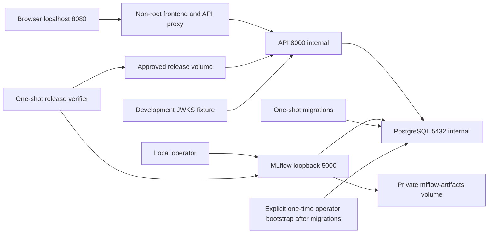
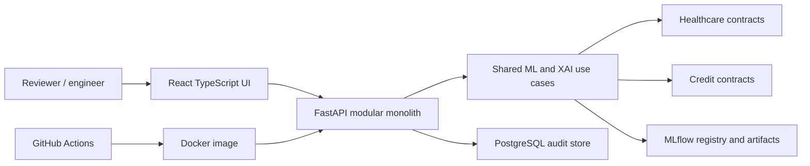

# Deployable architecture and tooling decision

## Current Azure Workload Profiles deployment (2026-10-19)

The approved cloud path is public HTTPS `frontend` → same-environment
`http://api` → `http://mlflow`, with API and MLflow private ingress and
PostgreSQL Flexible Server reached over verified TLS using separate
least-privilege roles. ARM 2026-07-01 reports environment mode
`WorkloadProfiles`, provisioning `Succeeded`, one Consumption profile and no
VNet or Log Analytics destination. API/MLflow FQDNs contain `.internal.`;
external direct probes return 404 while frontend-routed health and an
authenticated prediction succeed. API is 1 vCPU/2 GiB and all serving apps
are min 0/max 1. The existing Express environment and all four old apps
remain stopped, retaining their evidence and deny rules.

The deployment source is `deployment/azure/`. `ci-plan.bicep` validates and
previews only the already existing resources. The CI script updates app images
by immutable ACR digest, uses a stopped-by-default no-ingress operator for
migration and smoke prediction, and can route traffic back to prior revisions.
GitHub Actions uses an Entra federated identity credential and narrowly scoped
RBAC; no long-lived Azure credential is stored in GitHub. The workflow is
implemented and verified by successful hosted
[run 39277474682](https://github.com/Ameya5006/Aletheia/actions/runs/39277474682)
at commit `929b10deb901c715bee05aaba52ac1db3ccbeb80`. Migration observation,
digest deployment, authenticated public prediction and real API/MLflow health
isolation passed; the operator is stopped. The user's explicit one-time Git
exception authorized the closure commits and bounded CI repairs. The first
failed run and its Windows/Linux newline correction remain historical evidence.
The 2026-10-19 Cost Management read returned a nonzero INR
11.7066685215817 month-to-date pre-tax amount, mostly from the earlier
Express apps; a numeric zero future forecast is not asserted. The historical
ingress checkpoints below are preserved for the supervisor.

Repository Actions variables named
`AZURE_CLIENT_ID`, `AZURE_TENANT_ID` and `AZURE_SUBSCRIPTION_ID` with the
existing federated application's non-secret identifiers are configured and
verified. Matching encrypted repository settings provide automatic log masking;
the workflow reads those masked settings. No client secret or certificate is
stored in GitHub, and account identifiers are not embedded in source. The four
`deployment/azure/ci-*-role.json` files are role templates: substitute the
literal `${AZURE_SUBSCRIPTION_ID}` placeholder in process memory before an
authorized role-definition operation. The existing live roles and federation
were preserved; template sanitization grants no new permission. This follows
the task's stricter account-identifier handling rule even though these IDs
are not passwords. The user's one-time exception authorizes only this reviewed
closure commit/push and the smallest corrections for hosted workflow defects.

The controlled operator additionally needs the registered
`Microsoft.App/containerApps/getAuthToken/action` and
`Microsoft.App/containerApps/revisions/replicas/read` for CLI console-log reads.
`ci-operator-log-role.json` grants these operations only at the operator app
assignment scope. It complements the existing logstream data action; API,
frontend and MLflow do not receive this token action. There are ten CI role
assignments, no exec/secret-list permission and no long-lived Azure credential.

## 2026-10-18 private-ingress repair audit

The existing Express API and MLflow apps were kept stopped while internal
ingress was disabled and re-enabled through the CLI, then patched through
ARM 2025-07-01. Both accepted `external:false`, but neither acquired the
`.internal.` FQDN expected by the general Container Apps guide. The Express
feature guide instead says apps communicate by public URLs and short-name
service discovery is unavailable. The frontend remains configured for its
prior HTTPS upstream, and the backend's MLflow endpoint remains unmodified;
neither route has been reopened. API and MLflow retain deny-all ingress rules.
The stopped apps and all eight resources are preserved for supervisor review.
The observed mismatch does not establish a usable private Express topology.

## Historical 2026-10-18 Azure checkpoint: implementation stopped at private ingress

The current Azure resource group has one Consumption Express environment,
one Standard ACR, one pull identity, one PostgreSQL Flexible Server, and four
Container Apps: public frontend, backend API, MLflow and a temporary controlled
bootstrap/migration app. PostgreSQL holds separate application and MLflow
databases; Alembic reached `0004_case_input (head)` through the temporary app.
The supervisor-approved bounded showcase uses PostgreSQL's Azure-services
firewall exception with TLS and least-privilege users because Express did not
report a finite outbound IP set. No paid VNet or private DNS was added.

The intended routing is browser to frontend HTTPS, frontend proxy to backend
HTTPS, backend to MLflow and PostgreSQL, and MLflow to PostgreSQL. A direct
outside request to the backend FQDN returned HTTP 200 even though Azure
reported `ingress.external=false`. Deny-all ingress blocked both direct and
frontend-proxied traffic. Tested narrow allow rules and the `.internal.` FQDN
did not provide a private working path. This means the approved architecture
has **not** been verified or activated. Frontend, API, MLflow and temporary
app are stopped; API and MLflow have deny-all ingress restrictions. No real
Azure prediction or persistence verification has occurred. The exact probes,
image digests and remaining work are in `docs/SUPERVISOR_HANDOFF.md`. A revised
topology requires external supervisor review before reopening service ingress.

## Historical 2026-10-17 Azure checkpoint

The local Compose application and interactive workflow were implemented after
the historical design snapshot below. Azure currently contains only the
Southeast Asia Consumption environment, Standard ACR, pull identity and
public static frontend; the backend, MLflow, PostgreSQL, migration and CI/CD
are not deployed. The frontend HTTPS health route passed, but the application
cannot serve predictions. The exact outbound IP list required by the approved
public PostgreSQL firewall is `null` in Azure's app control-plane response,
including a delayed reread after outbound traffic. This triggers the current
task's network hard stop. The complete current design and cost decision are
recorded in `docs/CURRENT_TASK.md` and ignored
`artifacts/azure-preflight/{RESOURCE_GATE_SEA_20261017,EGRESS_GATE_20261017}.md`.
No database networking relaxation or paid private networking was deployed.

## Historical design snapshot

Status: research Milestones 1-3 and local Milestone 4 Stages 1-2 are implemented.
FastAPI/PostgreSQL migrations, MLflow import/lifecycle, JWT/local-entitlement RBAC
and React/TypeScript have local verification recorded in PROJECT_REPORT.md.
Real external OIDC-provider integration is unverified; sign-out clears the local
session, with live OIDC logout a Stage 3 verification item. Docker Compose, CI/CD,
public hosting and production monitoring remain unimplemented. This document
preserves deployment design and does not authorize Stage 3.

## Macro Milestone 4 Docker Compose runtime contract — unimplemented

Choose self-hosted local MLflow with a PostgreSQL backend and filesystem artifact
volume. This resolves DagsHub versus self-hosting for the first implementation;
hosted storage is deferred to Macro Milestone 5. MLflow artifacts use its private
HTTP artifact proxy so clients do not need direct volume access. No S3 emulator,
object-storage service or unrelated database is needed for this workload.
The application remains one API modular monolith plus a static frontend; MLflow
and PostgreSQL are infrastructure, not independently distributed business services.

| Compose service/job | Health and startup | Volumes and ports | Initial resource budget |
|---|---|---|---|
| `postgres` | `pg_isready`, then authenticated queries to separate app/MLflow databases | named `pgdata`; 5432 internal only | 512 MiB RAM, 1 CPU, small connection pool |
| `migrate` | one-shot app owner job after healthy PostgreSQL; API depends on successful exit | migration code from image; secrets read-only; no host port | 256 MiB temporary |
| `mlflow` | DB schema initialized by single server startup; `/health` plus operator registry query | named `mlflow-artifacts`; container 5000 to `127.0.0.1:5000` for dev operator only | 768 MiB, 1 CPU, one worker |
| `release-import` | explicit operator profile; after healthy MLflow and migrated app DB; verification and import only | original evidence read-only bind; new `approved-release` volume write; no raw data | 768 MiB temporary; stop after import |
| `api` | liveness and readiness; healthy DB, completed migration, approved verified release required | `approved-release` read-only; 8000 internal only; writable temporary directory on tmpfs | 768 MiB, 1 CPU, one worker and one inference thread |
| `frontend` | HTTP static readiness; proxy propagates API health errors | compiled static files in image, writable tmpfs if needed; container 8080 to `127.0.0.1:8080` | 128 MiB, 0.5 CPU |
| `dev-identity` | local signed-token/JWKS fixture health; development/test profiles only | ignored generated key mounted read-only; private network; optional loopback test port | 128 MiB |

Budgets total about 2.25 GiB for steady application services and dev identity,
plus Docker/OS overhead; these are targets for an 8 GB laptop, not measurements.
Run imports and browser test/build jobs sequentially, not alongside training or
many workers. Static frontend avoids a resident Node dev server in the normal
Compose stack. Do not add Grafana/Prometheus or an identity platform just for
presentation. Later smoke tests must measure actual RAM/startup and adjust
budgets openly if the laptop cannot run this topology.

Startup: PostgreSQL healthy → migration completes; MLflow healthy → explicit
import/approval creates release; API verifies pin/DB → readiness; frontend
remains available to show an unready API. `depends_on` health/completion
conditions order startup but do not provide runtime availability; API connection
retry is bounded and requests still fail closed. See [Compose startup ordering](https://docs.docker.com/compose/how-tos/startup-order/).
On a fresh environment readiness stays false until explicit approved import and
entitlement bootstrap via the one-time operator command specified in
[ARCHITECTURE.md](ARCHITECTURE.md). Bootstrap requires configured synthetic/deployment
issuer/subject, completed migrations and no prior/conflicting state; grant and
append-only system event commit together. It is never automatic or public.
Restarting the stack must not automatically bootstrap, re-register,
change aliases or regenerate research evidence.

Every long-running container runs as a non-root UID; bind high ports and
pre-create owned volume directories in a bounded initialization job. Pin tested
image digests during implementation, drop unnecessary capabilities, no Docker
socket, read-only root filesystem where supported, limited tmpfs and private
networks. Package only approved byte-preserving provenance and the exact model
bundle, never the raw archive/CSV. Git-normalized Linux source is not a substitute
for the original byte-bound evidence snapshot. Mount original artifacts read-only
even for imports; output belongs to a new release volume. MLflow artifact volume
is private; API has only the approved release copy and cannot modify registry data.

Configuration names: `APP_ENV`, `DATABASE_URL`, `MLFLOW_TRACKING_URI`,
`MLFLOW_REGISTRY_URI`, `APP_MODEL_VERSION`, `APP_RELEASE_SHA256`,
`APP_RELEASE_ROOT`, `OIDC_ISSUER`, `OIDC_AUDIENCE`, `OIDC_JWKS_URI`,
`OIDC_CLIENT_ID`, `OIDC_MAX_TOKEN_LIFETIME_SECONDS`, `CORS_ALLOWED_ORIGINS`;
operator-only bootstrap configuration uses `BOOTSTRAP_OIDC_ISSUER` and
`BOOTSTRAP_OIDC_SUB`. The JWT maximum is validated against the selected issuer's
access-token configuration and signed-token tests in Stage 1; no public provider
is selected. Frontend public configuration uses
same-origin `/api/v1` and public OIDC settings only. DB passwords/registry
credentials/dev signing keys use mounted ignored secret files or environment
injection, not image build arguments. API startup rejects missing secrets or
development identity in release mode. DB owner and MLflow roles are separate
from runtime app credentials. No credentials/default production password is
committed; future templates may contain placeholders only.

Profiles: `dev` has loopback bindings/dev identity and optional frontend hot
reload; `test` uses separate ephemeral DB/artifact/release volumes, synthetic
subjects/cases and contract-test runner. Test fixtures never mount raw or
holdout data. Approved artifact parity tests may read the frozen model and saved
synthetic example but do not train or score holdout. Host `venv` remains a
fallback for research inspection, not a substitute claim for Compose verification.

Shutdown drains API for at most 15 seconds and closes DB connections; Compose
grace period 30 seconds lets PostgreSQL flush. Normal stop retains named volumes;
no automatic volume deletion. Restart verifies hashes, migrations, chain head,
approval and idempotency records before readiness. Backup/restore both DBs and
artifact/release volumes with a consistent inventory; restore rehearsals verify
release hashes and audit sequence/head, with no holdout access. A corrupt release
is quarantined and replaced from verified backup, never regenerated by a runner.

## Dependencies and alternatives — local packages implemented, images pending

Stage 1/2 package locks and local compatibility/license checks are implemented.
Container images and Compose verification remain Stage 3 gates. Published license families include
[MLflow Apache-2.0](https://github.com/mlflow/mlflow),
[FastAPI MIT](https://github.com/fastapi/fastapi),
[Pydantic MIT](https://github.com/pydantic/pydantic),
[SQLAlchemy MIT](https://github.com/sqlalchemy/sqlalchemy),
[Alembic MIT](https://github.com/sqlalchemy/alembic),
[PyJWT MIT](https://github.com/jpadilla/pyjwt),
[psycopg LGPL-3.0](https://github.com/psycopg/psycopg),
[PostgreSQL License](https://www.postgresql.org/about/licence/),
[axe-core MPL-2.0](https://github.com/dequelabs/axe-core) and
[Playwright Apache-2.0](https://github.com/microsoft/playwright).
This license-family inventory is not legal clearance; container/base-image and
transitive notices still require version-specific review. Package pins are in
the Python/frontend locks; image pins remain pending. The frozen ML runtime may
not be silently upgraded.

MLflow is needed for reviewed version/alias lifecycle; local JSON alone lacks
multi-user registry workflow. FastAPI/Pydantic provide typed HTTP schemas over
existing functions; Flask/manual schemas are possible but add contract work.
SQLAlchemy with psycopg and Alembic provides explicit transactions/migrations;
raw SQL is simpler initially but repeats mapping/migration machinery. PostgreSQL
is needed for concurrent review/idempotency/audit writes; SQLite remains suitable
for small tests but cannot replace PostgreSQL integration evidence. PyJWT with
crypto and a reviewed OIDC browser client supply standard signature/PKCE plumbing;
custom cryptography/passwords are rejected. React/TypeScript with Vite supports
the implemented evidence/review interaction; server-rendered pages would reduce the
toolchain but make these stateful flows less convenient. Vitest/Testing Library,
axe-core and Playwright are implemented component/accessibility/browser-test tools. A small
SVG chart layer with accessible tables avoids a large chart dependency initially.
Docker/Compose and a non-root static proxy make the local topology reproducible;
native host services are a fallback but lose the same packaging evidence.

Local software has no hosted subscription requirement; CPU, memory, disk and
operator maintenance remain costs. External OIDC provider/host cost and region
are unresolved for future public hosting. If dependency compatibility fails,
pause that implementation stage and report the blocker; existing read-only
research evidence remains usable. Do not add another service or change the
frozen model merely to work around it.

## Deferred placement

CI/CD, cloud/public hosting and measured drift monitoring belong to Macro
Milestone 5 under separate approval. LLM/LangChain/OpenRouter narration could
later format already computed safe evidence, but deterministic prose suffices.
Vector databases/tool calling require a genuine retrieval/tool workflow;
similar-case retrieval itself needs privacy/method review first. Collaborative
filtering belongs to a different recommendation problem. Redis/shared rate
limiting, Kafka/queues, microservices and Kubernetes need measured concurrency,
asynchronous work or orchestration evidence. Multiple database technologies,
DVC/object stores/hosted MLflow and new model training are deferred; training
would need a new protocol and independent test population. None is implemented.

## Earlier broad tooling map — historical design context

The matrix below preserves the previous multi-milestone design. Where it differs,
the approved application contract in ARCHITECTURE.md governs the first application:
fixed synthetic input, precomputed local explanation, local self-hosted MLflow,
no automatic training/evaluation and no similar-case retrieval.

At the time of this historical broad design, no API/server, UI, database, MLflow registry/service, authentication/RBAC, containerized deployment, CI/CD, monitoring or LLM/RAG was implemented. Similar-case retrieval is also unimplemented. Selected and provisional tools below are future architecture decisions, not installed or deployed components. Macro Milestones 4 and 5 require separate authorization; no clinical readiness, fairness certification, production scale or deployment is claimed.

The diagram describes the **future delivery architecture**, not a running system:

The current credit package remains at `src/aletheia/data`, `ml`, and `experiments`. Healthcare policy is at `src/aletheia/domains/healthcare`. Shared use cases may be extracted only once both domains need them. Domain target, roles, split and future recourse constraints cannot be shared blindly. HTTP and UI call validated use cases; they never reimplement transformations. Future prediction flow: authenticated request → role/schema validation → registered fitted pipeline → probability/calibration → local explanation and similar training cases → append-only audit event → response. The API must not accept raw identifiable health records in the public demo.

## Historical tooling matrix

Each row preserves its historical design status, role and connection, configuration and artifact, risks and alternative; current implementation status is at the top of this document. Milestone numbers refer to `PRODUCT_REQUIREMENTS.md`.

| Tool | Status / milestone | Role, caller, input → output | Config, security, failure and alternative |
|---|---|---|---|
| Python 3.12, pandas, scikit-learn | Implemented / 1–3 data, model/calibration and research audit | CLI research use cases consume validated tables and the frozen fitted pipeline → metrics and aggregate explanations/audits | `pyproject.toml`, lockfile, TOML contracts. Fit preprocessing only in group folds. 8 GB limits wide one-hot tables. Polars is an alternative but increases migration cost. |
| Local immutable manifests | Implemented for credit and healthcare / 1–3 | Research runs → inspectable JSON identities and results | Ignored `artifacts/runs`, `artifacts/healthcare-model-v1`, `artifacts/healthcare-audit-v1`; no concurrency/remote registry. Future MLflow migration requires approval and preserved evidence. |
| MLflow | Selected / 4 | Training use case logs parameters, metrics, artifacts and model versions → registry IDs consumed by API | `MLFLOW_TRACKING_URI`, credentials in secret store. Avoid PHI in runs; registry availability and artifact compatibility are risks. Local manifests alone lack approval lifecycle. |
| DagsHub-hosted MLflow | Provisional / 4 | Remote MLflow backend for public non-sensitive experiment metadata | Endpoint/credentials secret; pricing, availability, retention and access must be reviewed. Self-hosted MLflow with object storage is fallback. No patient-level data uploaded. |
| DVC | Provisional / 2–4 | Version data pointers and checksums alongside Git; training consumes pinned source identity | `dvc.yaml` only after adoption; remote storage/access/cost must be evaluated. Current pinned UCI bytes + Git contracts/lock are a justified lightweight alternative for one public immutable source. |
| FastAPI | Selected / 4 | Typed REST adapter calls validated model/audit use cases → versioned response/OpenAPI | `DATABASE_URL`, registry URI, auth issuer/audience, model stage. Prevent identifier leakage, validate input, rate limit. Django REST is heavier; direct notebook serving is unsafe. |
| PostgreSQL | Selected / 4 | API records model version, request hash/reference, prediction, explanation ID and append-only review event | `DATABASE_URL` secret, migrations, encryption, least privilege, retention. Transaction/connection failures must fail closed for audited prediction. SQLite lacks intended concurrent managed operation. No raw clinical record storage. |
| React + TypeScript | Selected / 4 | Browser reviewer dashboard consumes API JSON → comparison and encounter review | `VITE_API_BASE_URL`; avoid storing health data in browser/local storage. Next.js adds server complexity without a current need. |
| Docker + Compose | Selected / 4 | Package API and local development dependencies → reproducible containers | Image pinning, secret injection, nonroot runtime, health checks; Compose is local only. Direct host installs drift; Kubernetes unjustified. |
| GitHub Actions | Selected / 5 | CI runs tests, formatting, security checks, image build → evidence and deploy gate | OIDC/short-lived secrets, protected environment, no raw data. Hosted runner limits/network failures; local command fallback. Future code graph parses Python/TypeScript imports, detects cycles/forbidden directions, publishes CI artifact and maps nodes to architecture. |
| Managed public deployment | Provisional / 5 | Host API/UI and managed PostgreSQL, use registry artifact → public demonstration | Vendor, region, cost and availability unresolved; use only synthetic/de-identified examples. Self-hosted VPS is fallback with more operations burden. Deployment is blocked until auth/audit/privacy checks. |
| Monitoring/drift checks | Selected / 5 | API operational metrics + approved aggregate feature/prediction distributions → alerts and review | No raw identifiers in logs; thresholds/baselines versioned. Drift is a signal, not proof of model harm. Manual periodic review is fallback. |
| Hugging Face cards | Selected / 2–5 | Publish model/dataset documentation, provenance and limitations → inspectable public evidence | No fitted model or sensitive data upload without approval; licenses and provenance required. Markdown in repo is fallback. Optional hosted demonstration is provisional and must remain synthetic. |
| OpenRouter narrator | Provisional / 5 | Optional text rendering of already computed explanation evidence → reviewer prose | API key secret; no patient values sent; hallucination and cost risk. Deterministic templates are default fallback. Narration cannot create evidence. |
| Authentication + RBAC | Selected / 4 | Identity provider claims → engineer/reviewer/admin permissions | OIDC issuer/audience, server-side policy, short sessions. Simplified demo auth still needs enforced roles; unauthenticated public predictions are rejected for real data. |
| Immutable audit logging | Selected / 4 | API writes append-only event and hash chain/version → replayable decision trace | PostgreSQL transaction, restricted writes, retention/export checks. DB administrator can still alter storage without external anchoring; cryptographic anchoring may follow. |
| RunwayML | Rejected | No legitimate tabular audit role | Media-generation cost/dependency would not solve a requirement. Reconsider only for a genuine visual media need. |

Implemented flow: official HTTPS archive → SHA-256 verification → controlled two-member extraction → strict CSV/schema/target validation → discharge-eligible cohort → feature and audit views → locked patient split → training-only nested group CV/model comparison and calibration → frozen selection and trusted local joblib artifact → one locked holdout evaluation. The completed audit then uses the unchanged calibrated model, training-only XAI/stability, counterfactual feasibility and one separately guarded post-selection subgroup audit → aggregate evidence and checksummed manifest. This repair only inspects existing records; no part of either run is repeated.

The historical registry/serving proposals above are superseded by local Stage 1 frozen import, verified MLflow packaging and an explicit approved release pin, without retraining. Secrets belong in future deployment secret managers/environment, never TOML or Git. Self-hosted MLflow is implemented locally; public host, hosted registry and DVC remain deferred. Future network outages, registry unavailability, schema/version mismatch and audit-write failure must prevent untracked serving. The five-milestone statuses and definitions of done agree with [PRODUCT_REQUIREMENTS.md](PRODUCT_REQUIREMENTS.md) and [EXECUTION_PLAN.md](EXECUTION_PLAN.md); existing evidence is in the [model card](model_cards/healthcare_readmission_v1.md), [PROJECT_REPORT.md](PROJECT_REPORT.md) and [SUPERVISOR_HANDOFF.md](SUPERVISOR_HANDOFF.md).
