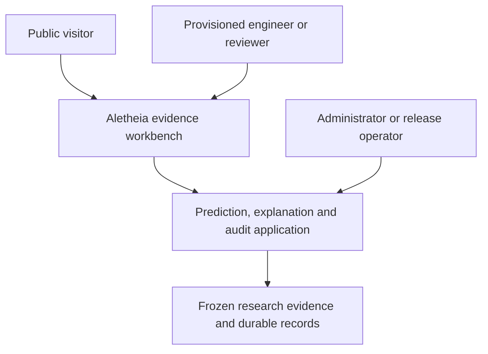
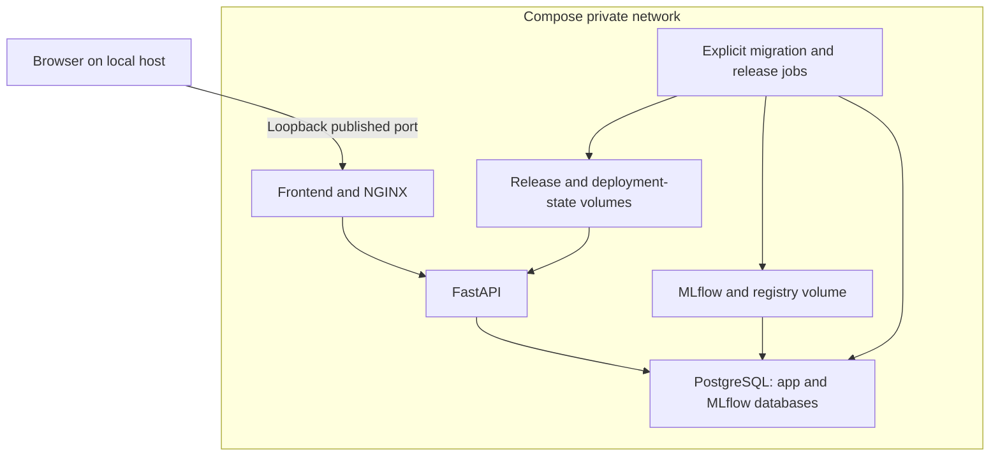
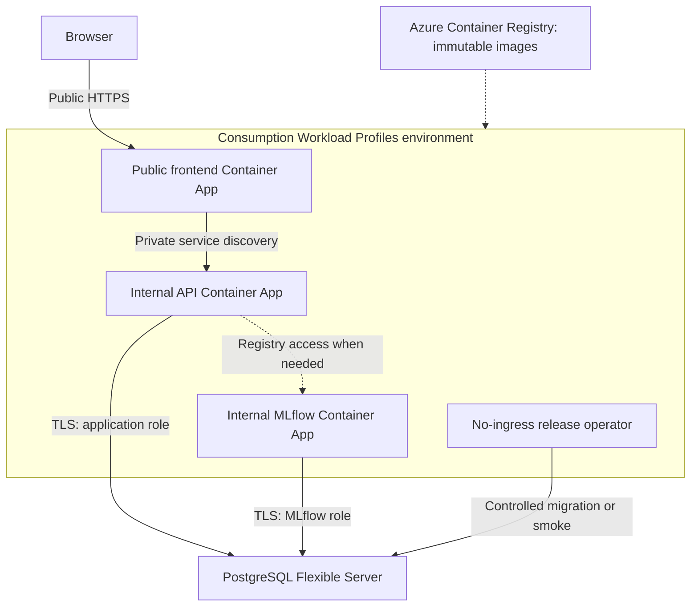
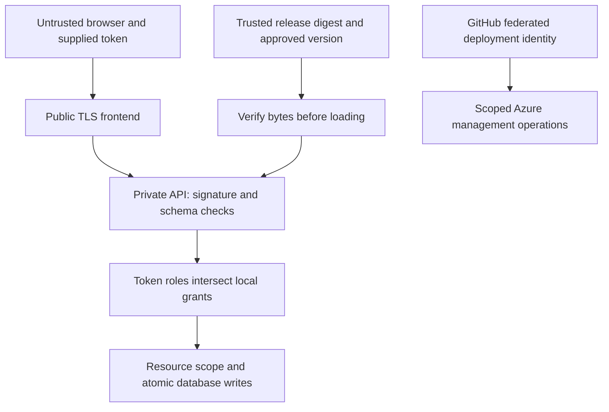
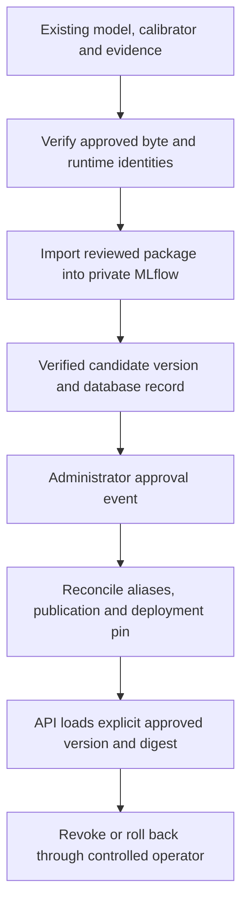
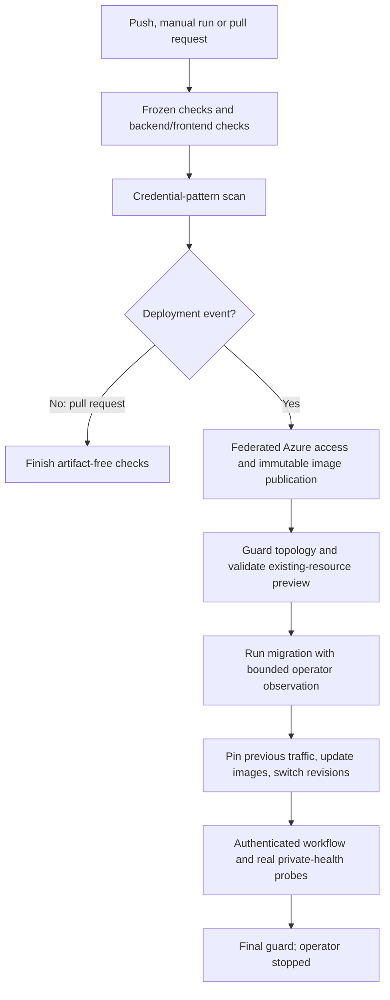
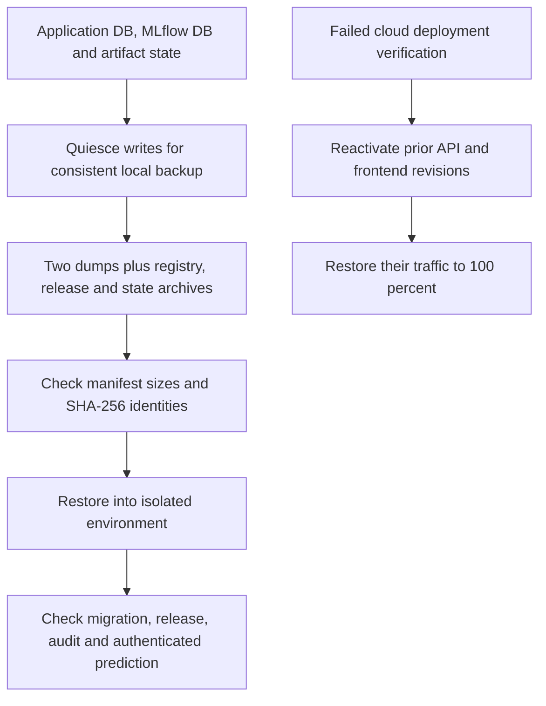

# Aletheia high-level design

[README](../README.md) · [Low-level design](LOW_LEVEL_DESIGN.md) · [Maintainability](SOLID_AND_MAINTAINABILITY.md) · [Architecture record](ARCHITECTURE.md)

This document describes the implemented showcase. Historical proposals in the
architecture records are not additional running capabilities. Source links identify
the implementation; dated verification belongs to the [project report](PROJECT_REPORT.md).
This presentation work changes no application or infrastructure behavior.

## Context, actors and product boundary

Aletheia is an educational workbench for examining a frozen healthcare
readmission classifier. A visitor can inspect published evidence. A provisioned
engineer can enter an illustrative case, run a prediction, save it and reopen it.
A reviewer can inspect authorized predictions and append review decisions.
An administrator manages entitlements and approved model releases through
controlled operator commands. These are explicit roles, not an inheritance tree.

The product accepts thirteen required structured fields, not uploaded records,
free text or bulk requests. It returns calibrated probability, a descriptive
0.5 threshold category and a reference-dependent, noncausal explanation.
It is not a clinical decision system. Research training, held-out evaluation and
calibration fitting are offline historical work; serving never repeats them.
The [input contract](../src/aletheia/application/case_input.py) and
[release adapter](../src/aletheia/application/release.py) enforce that boundary.

## Major responsibilities

| Component | Responsibility and boundary |
| --- | --- |
| [React/TypeScript frontend](../frontend/src/App.tsx) | Entry forms, evidence views, history and review; consumes API contracts rather than implementing model logic. |
| [NGINX](../deployment/nginx.conf.template) | Static assets and same-origin API proxy; only local published service. |
| [FastAPI application](../src/aletheia/application/api.py) | Validation, authentication, request limits, readiness, versioned responses and use-case orchestration. |
| [VerifiedRelease](../src/aletheia/application/release.py) | Verifies bytes/runtime before trusted loading; executes frozen preprocessing, model, external calibration and explanation. |
| [Store](../src/aletheia/application/store.py) | Entitlements, resource scope, release approval, atomic prediction/review/audit/idempotency writes. |
| [MLflow registry adapter](../src/aletheia/application/registry.py) | Imports and verifies an existing release; reconciles registry and database lifecycle state. MLflow is not the inference endpoint. |
| PostgreSQL | Separate application and MLflow databases and credentials; durable state across container replacement. |
| [Operator](../src/aletheia/application/operator.py) | Explicit bootstrap, grants and release lifecycle; no public bootstrap or promotion endpoint. |

This is a modular monolith with deployment adapters. Research modules do not
depend on FastAPI. Separate containers provide operational boundaries without
turning each Python module into a microservice.

## Local Docker topology

[compose.yaml](../deployment/compose.yaml) exposes only the frontend on
`127.0.0.1`. API, PostgreSQL and MLflow have no host ports. The private network is
internal; frontend also joins ingress. Named volumes are `pgdata`, `registry`,
`release` and `state`. API mounts release and state read-only. Mounted secret
files supply distinct runtime, migration-owner and MLflow credentials.
Operator profiles stage/import releases and run migrations explicitly.
[compose.test.yaml](../deployment/compose.test.yaml) adds test-specific support;
it is not an extra production service.

## Azure topology and ingress

The current environment uses one Consumption workload profile. Frontend, API
and MLflow have minimum zero and maximum one replica. API has 1 vCPU/2 GiB;
frontend has 0.25 vCPU/0.5 GiB and MLflow 0.5 vCPU/1 GiB.
The release operator is stopped by default and has no ingress. The earlier
Express environment and its apps remain stopped and preserved.
See [deployment architecture](DEPLOYMENT_ARCHITECTURE.md) and
[workload deployment template](../deployment/azure/workload-deployment.bicep).

Only frontend ingress is public. NGINX routes to `http://api`; private service
discovery also reaches `http://mlflow`. PostgreSQL requires TLS and retains the
approved bounded Azure-services firewall exception. It is not placed behind a
new private endpoint or VNet. There is no custom VNet, NAT, Private DNS or Log
Analytics workspace in this topology. ACR contains images, not application
history. Cloud model/release and registry artifact bytes are packaged in
immutable images; durable application and MLflow metadata live in PostgreSQL.
The [MLflow image](../deployment/azure/Dockerfile.workload-mlflow) and
[cloud entrypoint](../deployment/azure/cloud-entrypoint.sh) show the artifact path.

## Identity and security trust boundaries

Application identity and cloud deployment identity are different systems.
The showcase uses short-lived provisioned access tokens; public Signup and
production external OIDC onboarding are deferred. Frontend tokens stay in
memory. [TokenVerifier](../src/aletheia/application/auth.py) restricts algorithm,
issuer, audience, token use, lifetime and trusted JWKS source. Effective roles
are the intersection of signed roles and current database grants. Disabled
subjects lose access. Engineers have owner scope; reviewers/administrators have
broader authorized read scope, but Save remains owner-only and review requires
the reviewer role.

GitHub Actions uses OIDC federation for Azure operations without a stored cloud
password. App runtime credentials cannot perform migration-owner operations.
Secrets are injected at runtime, not published in documentation. File hashes
provide integrity only relative to a trusted anchor; they do not make arbitrary
joblib/pickle uploads safe. No such upload endpoint exists.

## Prediction and persistence lifecycle

1. The signed-in client fetches authenticated field metadata and submits
   `case-input-v1`, the approved model version and a UUID idempotency key.
2. Strict input validation canonicalizes the thirteen controls to ordered source
   strings. Extra fields and invalid categories/ranges are rejected.
3. Readiness verifies release bytes, migration state, identity availability and
   active database approval. Limits bound request size, rate and concurrency.
4. The frozen pipeline transforms the input using its existing fitted
   preprocessing. The probability callable applies the separate sigmoid
   calibrator; the base estimator probability alone is not the served result.
5. Paired permutation paths contrast the case with one published protocol
   reference. This live explanation is distinct from the historical research
   background explanation. It neither proves causality nor gives clinical recourse.
6. The store checks retry identity before inference and again under the database
   lock. Prediction snapshot, audit event and idempotency record commit together.
   A failed audit write prevents a successful prediction response.
7. Save appends history membership and a save audit event. Reopen reads the stored
   snapshot without inference. Loading values into a new form and rerunning
   produces a new prediction; the original is preserved.

Sources: [API](../src/aletheia/application/api.py),
[store transaction](../src/aletheia/application/store.py),
[case UI](../frontend/src/pages/CaseAnalysis.tsx) and
[migration 0004](../migrations/versions/0004_case_input.py).

Database triggers and grants protect append-only records; the audit chain links
canonical event hashes. This provides tamper evidence under a trusted checkpoint,
not protection from an unrestricted database owner rewriting all evidence.
Application PostgreSQL owns subjects, grants, model-version/release records,
prediction snapshots, saved membership, review events, audit events and retry
records. MLflow PostgreSQL owns registry/run metadata. Model bytes, image bytes,
database rows and backup files are separate storage responsibilities.

## Model and release lifecycle

[registry.py](../src/aletheia/application/registry.py) implements package
inventories, verified downloads, import receipts and reconciliation;
[operator.py](../src/aletheia/application/operator.py) exposes explicit
administrative commands. MLflow aliases and PostgreSQL updates do not share one
transaction, so partial publication must be reconciled before serving.
An alias alone does not authorize a release. Import does not train, evaluate the
holdout or select a model automatically. A healthy pinned API can serve without
request-time MLflow access; lifecycle work still needs the registry.

## CI/CD lifecycle

This diagram groups gates; the [workflow](../.github/workflows/azure-showcase.yml)
logs into Azure earlier on deployment events to retrieve verified frozen test
fixtures. Pull requests cannot retrieve those private fixtures and run a smaller,
artifact-free backend suite. Deployment publishes API/frontend images by digest;
it does not automatically replace MLflow. [ci-deploy.sh](../deployment/azure/ci-deploy.sh)
accepts only a no-change/ignored existing-resource preview, remembers prior
serving revisions and installs rollback handling before migration/deployment.
[ci-migrate.ps1](../deployment/azure/ci-migrate.ps1) stops the operator in cleanup.
Exact-image vulnerability scans, SBOMs and licence inventories have preserved
closure evidence; the workflow's credential scan is not a vulnerability scanner
or a claim that every image is vulnerability-free.

## Backup, restoration and rollback

The reproducible local rehearsal is
[restore.py](../deployment/tests/restore.py), with focused
[backup tests](../tests/deployment/test_backup.py).
The report preserves a five-file backup manifest and isolated restore evidence
at migration `0004_case_input`. That evidence is not a new cloud database
disaster-recovery rehearsal. Azure PostgreSQL also has the configured managed
backup retention recorded in the deployment report.

Revision rollback restores prior application traffic, not database contents.
The CI error handler makes best-effort activation/traffic calls; operator review
must verify recovery if Azure calls fail. Schema compatibility matters because
the workflow does not automatically downgrade migrations. Model rollback is a
separate approved-version lifecycle operation. Never regenerate a damaged frozen
release by retraining; recover verified bytes from approved storage.

## Scaling, failure domains and recovery

| Failure domain | Implemented response and practical limit |
| --- | --- |
| Cold frontend/API/MLflow | Scale-to-zero reduces idle compute but first requests may fail or be slow. Preserved checks demonstrate eventual recovery, not a latency SLA. |
| API load | Two in-process inference slots, per-process rate limits and deadlines; maximum one replica matches the showcase. Distributed rate coordination is not implemented. |
| PostgreSQL or audit failure | Readiness/write failure blocks confirmed predictions; transactions roll back incomplete evidence. One database server is a shared failure domain. |
| Identity/JWKS failure | Bounded trusted cache; unavailable or stale keys fail closed. No anonymous fallback. |
| Release corruption or approval mismatch | Startup/readiness fails; restore approved bytes and reconcile lifecycle state. |
| MLflow outage | Existing pinned inference can continue with valid DB approval; import/promotion and artifact refresh cannot. |
| Deployment/smoke failure | Restore prior API/frontend traffic; inspect operator logs and verify readiness. Successful green CI is not proof of every rollback scenario. |
| Browser timeout | User retries the same submission/key to resolve outcome. Client cancellation cannot guarantee termination of synchronous server work. |

Server operation deadline is at most ten seconds; the store checks a
three-second inference budget after inference and applies bounded database
statement/lock timeouts. These limits do not interrupt arbitrary CPU work
mid-instruction. Frontend timeout is twelve seconds. See
[client](../frontend/src/api/client.ts), [API](../src/aletheia/application/api.py)
and [store](../src/aletheia/application/store.py).

## Deferred capabilities and limitations

Public Signup, production external OIDC onboarding, clinical validation,
automated retraining/promotion, bulk intake, live causal or counterfactual advice,
similar-case retrieval, distributed scaling and production drift/alerting are
not implemented. Historical-data generalization and reference-dependent
explanations remain limited. The backend image retains documented vulnerability
findings; their inventories and dispositions remain in the
[project report](PROJECT_REPORT.md). Neither private ingress nor successful
tests establishes production certification.

For exact entities, endpoints and sequences, continue with the
[low-level design](LOW_LEVEL_DESIGN.md). For honest design trade-offs, read the
[maintainability assessment](SOLID_AND_MAINTAINABILITY.md).
