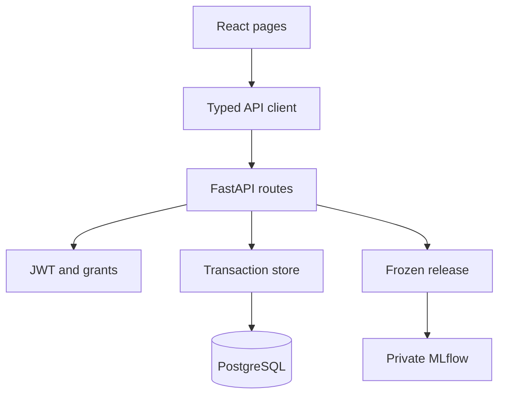
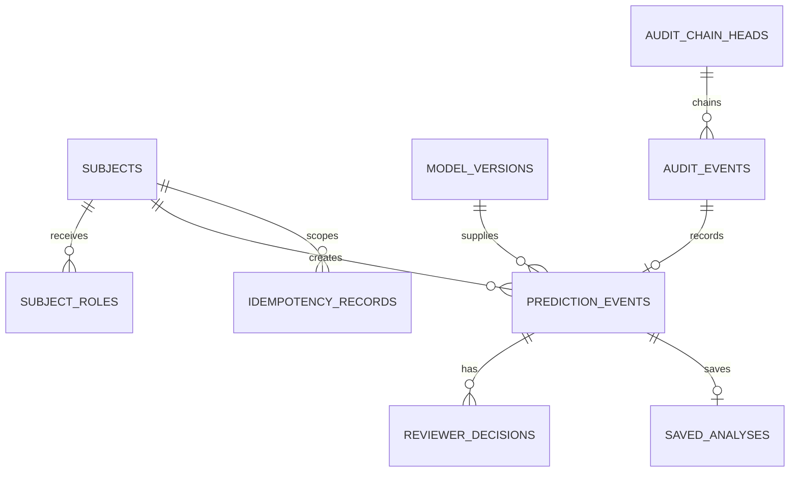
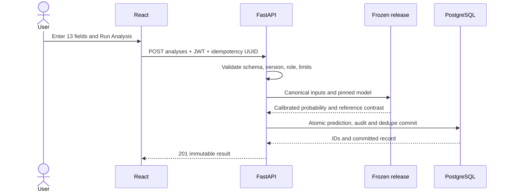
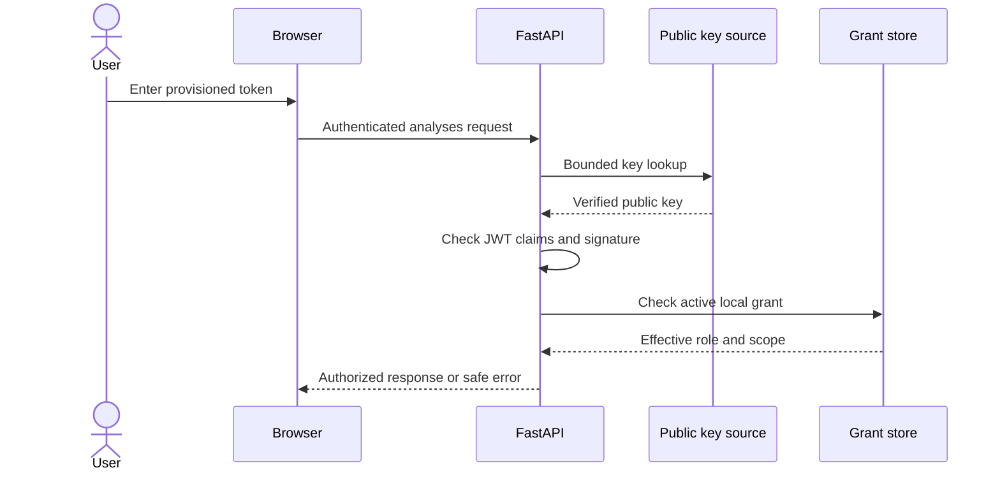
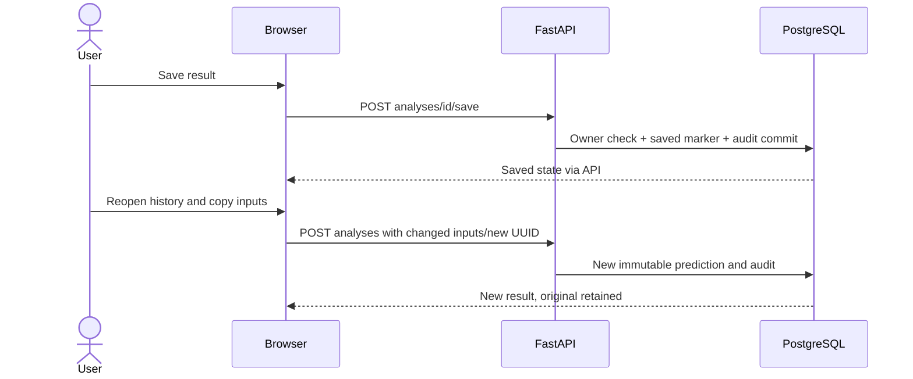
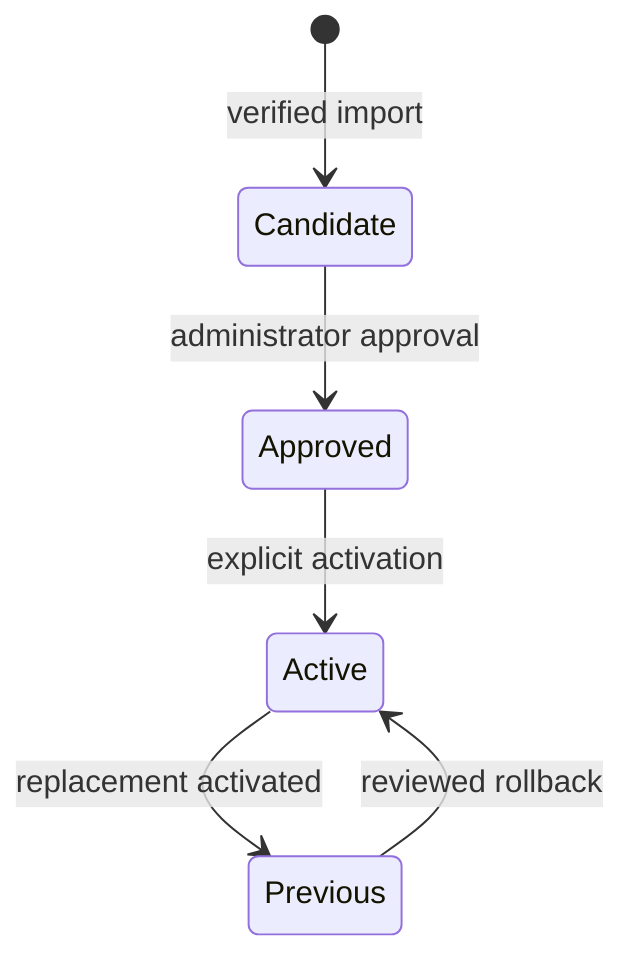
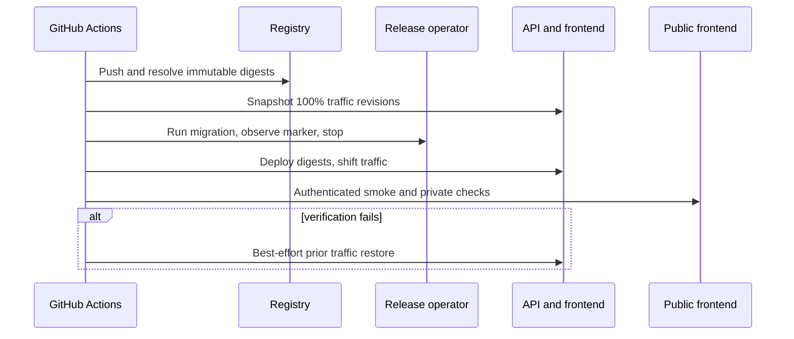

# Low-level design

This document describes the implemented educational showcase at the current
source commit. The [HLD](HIGH_LEVEL_DESIGN.md) describes service boundaries;
the [architecture record](ARCHITECTURE.md) preserves older decisions. The
application uses one frozen healthcare model and no serving-time fit.

## Source and module map

| Layer | Entry points and responsibility |
|---|---|
| API | [`api.py`](../src/aletheia/application/api.py) creates FastAPI routes, bounds requests, serializes responses and maps errors. |
| Identity | [`auth.py`](../src/aletheia/application/auth.py) verifies signed JWTs against bounded JWKS; [`store.py`](../src/aletheia/application/store.py) intersects claims with current database grants. |
| Intake | [`case_input.py`](../src/aletheia/application/case_input.py) defines the strict 13-field contract and maps values to the frozen pipeline's source strings. |
| Serving | [`release.py`](../src/aletheia/application/release.py) validates the pinned model/evidence bundle and produces inference and reference contrasts; [`pyfunc_model.py`](../src/aletheia/application/pyfunc_model.py) wraps the unchanged calibrated artifact. |
| Persistence | [`schema.py`](../src/aletheia/application/schema.py) owns SQLAlchemy tables; `store.py` owns transactions, idempotency, authorization and hash-linked audit writes. |
| Operations | [`operator.py`](../src/aletheia/application/operator.py) handles explicit release import, approval, activation, entitlements and bootstrap. |
| Browser | [`App.tsx`](../frontend/src/App.tsx) routes pages; [`session.tsx`](../frontend/src/auth/session.tsx) keeps tokens in memory; [`Analyses.tsx`](../frontend/src/pages/Analyses.tsx) handles case, history and reruns; [`AuditTrail.tsx`](../frontend/src/pages/AuditTrail.tsx) presents scoped events. |
| Cloud delivery | [workflow](../.github/workflows/azure-showcase.yml), [`ci-deploy.sh`](../deployment/azure/ci-deploy.sh), [`ci-migrate.ps1`](../deployment/azure/ci-migrate.ps1), [`ci-guard.py`](../deployment/azure/ci-guard.py) and [`ci-smoke.py`](../deployment/azure/ci-smoke.py). |

The UI has Overview, New Analysis, Analysis History, Saved Analysis, evidence,
review, audit, model card and provisioned-session routes. `App.tsx` defines the
route map. `Analyses.tsx` generates an idempotency UUID for each new submission
and retains it when a request must be retried. The browser's role labels only
guide display; backend grants determine access.

## Relational ownership and migrations

[`0001_backend.py`](../migrations/versions/0001_backend.py) creates core
identity/grant, model/release, prediction/review, audit and idempotency state.
[`0004_case_input.py`](../migrations/versions/0004_case_input.py) adds entered
case input and saved-analysis state with database integrity checks. The cloud
head is `0004_case_input`. Application and MLflow metadata use separate logical
databases on one PostgreSQL server. MLflow owns its metadata schema; Alembic
owns only application tables. The frozen model artifact is packaged read-only
in the private MLflow image. Local Compose uses persistent named volumes.

The diagram groups the key relationships; [`schema.py`](../src/aletheia/application/schema.py)
has the exact columns, constraints and table names. Database triggers reject
history mutation and inconsistent event/saved-analysis relationships. The
chain is tamper-evidence under a trusted checkpoint, not protection from a
privileged database owner who can rewrite all storage.

## HTTP contract and request boundaries

All product routes use `/api/v1` via the frontend's same-origin `/api` proxy.
`GET /health/live` checks process liveness; `GET /health/ready` checks serving
dependencies. `GET /models/current` and its card, selected public evidence
routes and `GET /analyses/schema` publish bounded reference information.
`POST /analyses` takes `schema_version=case-input-v1`, a pinned model version,
13 inputs and a UUID `Idempotency-Key`. It returns HTTP 201 with the immutable
prediction, calibrated probability, explanation, identities and audit ID.
`POST /analyses/{id}/save` marks an owned prediction for history; `GET
/analyses` lists saved records and `GET /analyses/{id}` reopens one.
`POST /predictions` is the older fixed protocol-case path. Review endpoints
under `/predictions/{id}/reviews` require reviewer role. `/audit-events`
returns scoped committed events. `/admin/model-versions` requires administrator
rights. `GET /session` exists only for development/test identity mode; cloud
provisioned sign-in validates by an authenticated analyses request.

Pagination is bounded by `1 <= limit <= 100`. Analysis history orders by
descending random UUID, so its order is not a chronology guarantee. Response
envelopes carry data, evidence and safe error context. External requests are
validated and size/time bounded before entering store operations.

## Input, inference and explanation sequence

`CaseInput` forbids extra fields and requires strict types. Categorical codes
must be listed in the mapping; eight counts have integer bounds. Count ceilings
bound computation/transport and are not clinical normal ranges. `raw()` maps
numeric fields to the source strings expected by the frozen preprocessor.
There is no data-frame fit or model selection during serving. The approved
calibrated pipeline returns a probability. Reference contributions compare
the prediction to a frozen study reference and do not prove cause; model-level
stability evidence is likewise separate from case-specific stability.

## Authentication, authorization and secret flow

The public frontend can render evidence without credentials. A provisioned
reviewer/engineer enters a short-lived JWT at `/local-session`; the browser
holds it in memory. The API checks RSA signature, pinned algorithm, issuer,
audience, expiry and JWKS limits. It then intersects token roles with active
PostgreSQL grants. Invalid or expired tokens fail; absence of grants fails.
Review creation specifically requires reviewer role, even if an administrator
claim exists. Saving is owner-only even where an elevated role may read.
No permanent public Signup or external application OIDC provider is configured.
GitHub Actions OIDC is a separate deployment identity and supplies no browser
login. Secrets use ignored local files or Azure secret references; public keys
may be shared, private signing material and database URLs may not.

## Saving, rerunning and audit

The first prediction is immutable and audited whether or not Save is chosen.
Save creates the history marker and a linked audit event in one transaction.
Reopening reads the original snapshot. Loading its inputs into New Analysis
copies them into browser form state; a changed rerun creates a separate
prediction/audit identity and leaves the original unchanged. Reset clears
unsaved form state only. For repeated POSTs, the store binds idempotency key,
actor, route and request fingerprint; replay returns the original committed
result, while a conflicting body is rejected. An audit write failure prevents
the business command from being reported as successful.

Audit rows link event hashes and scope to actor/resource. The UI shows only
authorized events and does not claim to verify the complete chain.

## Model, migration and release state

The operator first verifies exact approved model/release/evidence bytes before
MLflow import. Candidate, approval and active state are explicit operator
actions. The API serves a pinned active version only when the database,
registry/release metadata and local artifact identities agree. A registry
outage prevents lifecycle changes; the approved pinned cache may continue
serving when its checks pass. None of these steps retrains or recalibrates.

In hosted CI, the no-ingress release operator must start stopped, update to an
immutable backend digest, run Alembic to `0004_case_input`, expose a bounded
sanitized completion marker, and stop in `finally`. The smoke task similarly
uses a short-lived synthetic identity to check the public path, persistence and
audit, then stops. Migration changes are not reversed by traffic rollback.

## CI/CD, rollback and failure handling

The [workflow](../.github/workflows/azure-showcase.yml) runs frozen checks,
OIDC login, fixture restoration, tests, frontend build and credential scan.
It builds and pushes API/frontend images, obtains immutable ACR digests, checks
the existing topology and Bicep what-if, migrates, updates app revisions and
smoke-tests through the public HTTPS URL. [`ci-deploy.sh`](../deployment/azure/ci-deploy.sh)
records the revisions actually carrying 100% traffic. Its `ERR` trap attempts
to reactivate them and restore 100% traffic if later verification fails.
Rollback is best effort; it does not delete new revisions or reverse migrations.

Requests may fail as validation errors (400/422), unauthenticated or forbidden
(401/403), unavailable state (503), rate or concurrency limits (429), conflicts
(409), or exceeded deadline (504). The API enforces a bounded request deadline
and an independent three-second inference limit. Frontend Retry preserves the
same idempotency key/body after an ambiguous timeout. Cold scale-from-zero can
cause a first readiness 504; operators should warm the showcase before review,
not raise deadlines to conceal it. Rollback, database restore and preserved
backup evidence address different failure domains.

## Configuration, tests and trade-offs

[`config.py`](../src/aletheia/application/config.py) validates environment
settings. Deployment examples contain placeholders. Azure runtime credentials
live in secret references; GitHub uses main-branch federated OIDC, with scoped
role actions and no long-lived cloud password. The model and release are
digest-bound; no user-supplied executable artifact is loaded.

| Behavior | Evidence in repository |
|---|---|
| Strict case intake and mapping | [`test_case_input.py`](../tests/application/test_case_input.py), [`test_case_workflow.py`](../tests/application/test_case_workflow.py) |
| JWT, roles and release agreement | [`test_release_auth.py`](../tests/application/test_release_auth.py), [`test_registry.py`](../tests/application/test_registry.py) |
| PostgreSQL transactions and recovery | [`test_postgres_api.py`](../tests/application/test_postgres_api.py), [`test_repair_postgres.py`](../tests/application/test_repair_postgres.py) |
| Frontend saved workflow | [`analyses.test.tsx`](../frontend/tests/analyses.test.tsx), [`cloud.spec.ts`](../frontend/browser/cloud.spec.ts) |
| Hosted guard and rollback boundaries | [`test_ci_rollback.py`](../tests/deployment/test_ci_rollback.py), [`test_ci_private_boundary.py`](../tests/deployment/test_ci_private_boundary.py), [`test_ci_log_marker.py`](../tests/deployment/test_ci_log_marker.py) |

The modular monolith keeps research and delivery code close enough to reuse
one frozen pipeline. The API/store and release modules remain substantial and
coupled to schema and artifact formats; the [SOLID assessment](SOLID_AND_MAINTAINABILITY.md)
records practical future splits. Cloud scale-to-zero saves idle compute but
adds cold latency. PostgreSQL's bounded Azure-services firewall exception is
accepted for this non-sensitive student showcase, not a production clinical
network pattern. The [project report](PROJECT_REPORT.md) records measured
limitations, source hashes and the engineering decisions behind this order.
